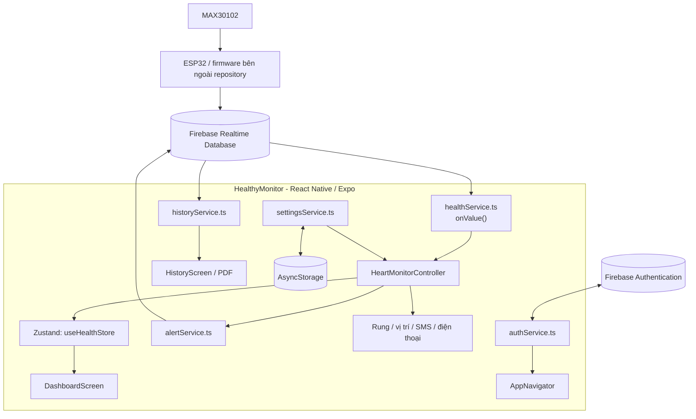

# HealthyMonitor

**Ứng dụng theo dõi nhịp tim (BPM) và độ bão hòa oxy ngoại vi (SpO₂) theo thời gian thực với React Native, Expo và Firebase Realtime Database.**

HealthyMonitor là ứng dụng di động trong hệ thống giám sát sức khỏe sử dụng **ESP32** và cảm biến quang học **MAX30102**. Ứng dụng nhận các chỉ số đã được thiết bị đưa lên Firebase, hiển thị số đo và biểu đồ, đánh giá các ngưỡng do người dùng thiết lập, quản lý lịch sử, xuất báo cáo PDF và hỗ trợ mở ứng dụng nhắn tin/gọi điện khi phát hiện vượt ngưỡng.

> [!IMPORTANT]
> README này được xây dựng từ **mã nguồn thực tế trong thư mục dự án**. Tệp ZIP hiện cung cấp **ứng dụng di động**, **không bao gồm** mã firmware ESP32, mã backend/API riêng hoặc mô hình AI. Một số chức năng đã có service nhưng chưa được kết nối đầy đủ vào luồng giao diện; xem [Giới hạn hiện tại](#11-giới-hạn-hiện-tại).
>
> **Dự án phục vụ học tập, nghiên cứu và thử nghiệm kỹ thuật; không phải thiết bị y tế đã được chứng nhận.** Không sử dụng ứng dụng để chẩn đoán hoặc thay thế theo dõi y tế chuyên nghiệp.

## Mục lục

- [1. Tính năng](#1-tính-năng)
- [2. Công nghệ sử dụng](#2-công-nghệ-sử-dụng)
- [3. Kiến trúc và luồng dữ liệu](#3-kiến-trúc-và-luồng-dữ-liệu)
- [4. Cấu trúc thư mục](#4-cấu-trúc-thư-mục)
- [5. Cài đặt và chạy ứng dụng](#5-cài-đặt-và-chạy-ứng-dụng)
- [6. Cấu hình Firebase](#6-cấu-hình-firebase)
- [7. Định dạng dữ liệu Firebase](#7-định-dạng-dữ-liệu-firebase)
- [8. Logic cảnh báo và SOS](#8-logic-cảnh-báo-và-sos)
- [9. Lưu trữ, lịch sử và báo cáo](#9-lưu-trữ-lịch-sử-và-báo-cáo)
- [10. Kiểm thử thủ công](#10-kiểm-thử-thủ-công)
- [11. Giới hạn hiện tại](#11-giới-hạn-hiện-tại)
- [12. Khắc phục sự cố](#12-khắc-phục-sự-cố)
- [13. Bảo mật và quyền riêng tư](#13-bảo-mật-và-quyền-riêng-tư)
- [14. Hướng phát triển](#14-hướng-phát-triển)
- [15. Giấy phép](#15-giấy-phép)

## 1. Tính năng

| Thành phần | Chức năng | Trạng thái trong mã nguồn |
| --- | --- | --- |
| Dashboard | Hiển thị BPM, SpO₂, trạng thái kết nối và hai biểu đồ biến thiên dữ liệu | Đã tích hợp |
| Cập nhật thời gian thực | Lắng nghe `health_data` bằng Firebase `onValue()` | Đã tích hợp |
| Đánh giá chỉ số | Hiển thị trạng thái bình thường / cần theo dõi / vượt ngưỡng | Đã tích hợp trong Dashboard |
| Ngưỡng cá nhân hóa | Lưu `maxBpm`, `minSpo2` bằng AsyncStorage | Đã tích hợp |
| Cảnh báo vượt ngưỡng | Ghi sự kiện vào `health_alerts`; rung điện thoại | Đã tích hợp trong Controller |
| SOS | Xin quyền vị trí, soạn đường dẫn GPS và mở giao diện SMS/cuộc gọi | Đã tích hợp; **không tự gửi tin nhắn hoặc tự thực hiện cuộc gọi** |
| Xác thực | Email/mật khẩu, đăng ký tài khoản, đăng nhập khách (Anonymous), đăng xuất | Đã tích hợp Firebase Authentication |
| Lịch sử | Đọc `health_history`, lọc hôm nay / 7 ngày / 30 ngày, thống kê và biểu đồ | Đã tích hợp phần **đọc** |
| Xuất báo cáo | Kết xuất dữ liệu lịch sử thành PDF và mở giao diện chia sẻ | Đã tích hợp trong HistoryScreen |
| Quản lý dữ liệu | Xóa toàn bộ lịch sử, xóa dữ liệu cũ hơn 30 ngày | Đã tích hợp |
| Hồ sơ người dùng | Lưu tên, tuổi, chiều cao, cân nặng, số điện thoại khẩn cấp | Đã tích hợp cục bộ |
| Giao diện | Chế độ sáng/tối, lưu lựa chọn giao diện | Đã tích hợp |
| Google Sign-in | Có dependency và mã gợi ý nhưng hàm đăng nhập hiện báo chưa hỗ trợ | **Tạm vô hiệu hóa** |
| Tự ghi lịch sử | Hàm `saveHealthHistory()` tồn tại nhưng lịch gọi định kỳ trong Controller đang bị comment | **Chưa hoạt động tự động** |
| Chẩn đoán thiết bị, danh sách cảnh báo | Có service/component riêng nhưng chưa được gắn vào các màn hình đang điều hướng | **Chưa hiển thị trong luồng chính** |

**Lưu ý:** Biểu đồ Dashboard giữ tối đa khoảng **20 điểm dữ liệu gần nhất trong bộ nhớ của màn hình**; đây không phải cơ chế lưu trữ lịch sử lâu dài.

## 2. Công nghệ sử dụng

Các phiên bản dưới đây được ghi theo `package.json` đi kèm dự án, không phải tuyên bố đã kiểm thử trên mọi thiết bị.

| Nhóm | Công nghệ | Phiên bản khai báo |
| --- | --- | --- |
| Mobile | React Native | `0.86.3` |
| Framework | Expo | `~57.0.24` |
| UI | React | `19.2.3` |
| Ngôn ngữ | TypeScript | `~6.0.3` |
| Backend as a Service | Firebase JavaScript SDK | `^12.19.0` |
| Cơ sở dữ liệu | Firebase Realtime Database | Dịch vụ đám mây |
| Xác thực | Firebase Authentication | Qua Firebase SDK |
| Quản lý state | Zustand | `^5.0.15` |
| Điều hướng | React Navigation (Stack + Bottom Tabs) | `7.x` |
| Biểu đồ | `react-native-chart-kit` / `react-native-svg` | `^7.0.4` / `^15.15.5` |
| Lưu cục bộ | AsyncStorage | `2.2.0` |
| Xuất file | `expo-print`, `expo-sharing` | `~57.0.x` |
| Vị trí SOS | `expo-location` | `~57.0.19` |

**Phần cứng trong hệ thống tổng thể:** ESP32 và MAX30102. Firmware cảm biến không nằm trong repository này; app chỉ tiêu thụ các giá trị BPM/SpO₂ đã được ghi lên Firebase.

## 3. Kiến trúc và luồng dữ liệu

### 3.1. Kiến trúc tổng thể



### 3.2. Dòng chảy một bản đo

1. Firmware của ESP32 (được triển khai **bên ngoài** dự án này) xử lý tín hiệu MAX30102 và ghi các trường BPM, SpO₂, trạng thái lên `health_data` trong Firebase Realtime Database.
2. `src/services/healthService.ts` đăng ký listener `onValue()` tại đường dẫn `health_data` và đọc dữ liệu qua `snapshot.val()`.
3. Service chuyển `bpm` và `spo2` sang `number`, thay giá trị không hợp lệ bằng `0`, lấy **`Date.now()` của điện thoại lúc nhận snapshot** làm `timestamp` và gọi callback.
4. `HeartMonitorController` cập nhật `healthData`, `isConnected` trong Zustand; đồng thời đánh giá ngưỡng đã lưu.
5. `DashboardScreen` sử dụng các selector của Zustand. Khi state thay đổi, React render lại chỉ số, biểu đồ và phần nhận xét.
6. Nếu vượt ngưỡng, Controller ghi một bản ghi cảnh báo xuống `health_alerts` và kích hoạt chuỗi SOS theo điều kiện bên dưới.

**Quan trọng:** `timestamp` trong giao diện realtime hiện **không phải thời điểm đo do ESP32 gửi lên**. Việc nhận được một snapshot hoặc trạng thái `isConnected=true` không tự chứng minh rằng dữ liệu cảm biến còn mới hay cảm biến đang tiếp xúc tốt.

### 3.3. Các lớp chức năng

- **Presentation:** `screens/`, `components/`, `navigation/`, `theme/` đảm nhiệm giao diện, điều hướng và chủ đề màu.
- **Application/State:** `HeartMonitorController.ts` điều phối subscription, cảnh báo, SOS; `useHealthStore.ts` chia sẻ trạng thái.
- **Data Access:** `healthService.ts`, `historyService.ts`, `alertService.ts`, `authService.ts`, `settingsService.ts` trao đổi với Firebase/AsyncStorage.
- **External Systems:** Firebase Realtime Database, Firebase Authentication, ESP32/MAX30102 và các ứng dụng gọi điện/nhắn tin trên hệ điều hành.

## 4. Cấu trúc thư mục

```text
App-HealthyMonitor/
├── App.tsx                          # Entry component, khởi động Controller
├── app.json                         # Cấu hình Expo
├── package.json                     # Dependencies, npm scripts
├── package-lock.json                # Khóa phiên bản phụ thuộc
├── tsconfig.json                    # TypeScript config
├── assets/                          # Icon, splash và ảnh ứng dụng
├── src/
│   ├── config/
│   │   └── firebase.ts              # Firebase app và Realtime Database
│   ├── navigation/
│   │   └── AppNavigator.tsx         # Auth stack và 3 tab chính
│   ├── screens/
│   │   ├── LoginScreen.tsx          # Đăng nhập email/guest
│   │   ├── RegisterScreen.tsx       # Đăng ký tài khoản
│   │   ├── DashboardScreen.tsx      # Chỉ số và biểu đồ realtime
│   │   ├── HistoryScreen.tsx        # Lịch sử và xuất PDF
│   │   └── SettingsScreen.tsx       # Hồ sơ, ngưỡng, quản lý dữ liệu
│   ├── components/                  # Các UI component tái sử dụng
│   ├── services/
│   │   ├── HeartMonitorController.ts  # Điều phối dữ liệu/cảnh báo/SOS
│   │   ├── healthService.ts         # Listener health_data
│   │   ├── historyService.ts        # Truy vấn, ghi, xóa lịch sử
│   │   ├── alertService.ts          # Ghi/đọc cảnh báo
│   │   ├── authService.ts           # Firebase Authentication
│   │   ├── settingsService.ts       # Cấu hình AsyncStorage
│   │   ├── deviceDiagnosticService.ts # Kiểm tra dữ liệu/kết nối
│   │   └── reportService.ts         # Module xuất PDF riêng (chưa được gọi)
│   ├── store/
│   │   └── useHealthStore.ts        # Zustand global state
│   ├── theme/                       # Light/dark theme
│   ├── types/
│   │   └── index.ts                 # Các TypeScript interfaces
│   └── utils/                       # Format và health analysis helpers
└── LICENSE                          # Giấy phép hiện có trong ZIP
```

## 5. Cài đặt và chạy ứng dụng

### 5.1. Yêu cầu

- **Node.js** và **npm** đã cài đặt (khuyến nghị phiên bản Node.js LTS tương thích với Expo SDK đang sử dụng).
- Điện thoại Android/iOS có môi trường chạy Expo phù hợp, hoặc Android Emulator; iOS Simulator cần macOS.
- Kết nối Internet để cài dependency và sử dụng Firebase.
- Một dự án Firebase có Realtime Database và các phương thức đăng nhập tương ứng.

Kiểm tra công cụ:

```bash
node --version
npm --version
```

### 5.2. Cài đặt dependency

Giải nén ZIP, mở terminal tại **thư mục chứa `package.json`**, sau đó chạy:

```bash
cd App-HealthyMonitor
npm ci
```

`npm ci` sử dụng `package-lock.json` để cài các phiên bản phụ thuộc được khóa. Nếu đổi các dependency thì cần cập nhật lockfile bằng công cụ npm phù hợp trước khi dùng `npm ci`.

### 5.3. Khởi động Metro/Expo

```bash
npm start
```

Các script hiện có:

```bash
npm run android       # Mở trên môi trường Android được cấu hình
npm run ios           # Mở trên môi trường iOS được cấu hình
npm run web           # Script được khai báo; hỗ trợ web chưa được xác nhận
```

Nếu Metro giữ cache cũ:

```bash
npx expo start --clear
```

**Expo Go:** Có thể thử với các chức năng dùng module được hỗ trợ, nhưng khả năng tương thích phụ thuộc phiên bản Expo Go/SDK và các native module của app. Google Sign-in hiện đã được tắt trong code; nếu cần native integration hoặc app production, hãy sử dụng development build phù hợp. Không mặc định rằng toàn bộ tính năng hoạt động trên Expo Go.

Có thể kiểm tra type ở mức TypeScript bằng:

```bash
npx tsc --noEmit
```

Lệnh này **không thay thế** kiểm thử chạy thực tế và không xác nhận tính đúng đắn về mặt y tế.

## 6. Cấu hình Firebase

### 6.1. Chuẩn bị dự án Firebase

1. Tạo hoặc sử dụng **Firebase project dành riêng cho môi trường thử nghiệm**.
2. Tạo ứng dụng dạng **Web** trong Firebase Console để nhận cấu hình của Firebase JavaScript SDK.
3. Bật **Realtime Database**, ghi nhận đúng `databaseURL` (có thể là URL database theo khu vực triển khai).
4. Trong **Authentication → Sign-in method**, bật **Email/Password** và **Anonymous** nếu muốn sử dụng đăng nhập khách.
5. Thiết lập **Realtime Database Security Rules** trước khi ghi bất kỳ dữ liệu sức khỏe thật nào. Không bật quyền đọc/ghi công khai để chạy thử nhanh.
6. Cập nhật cấu hình trong `src/config/firebase.ts` cho project Firebase của bạn.

Trong mã nguồn hiện tại, `firebase.ts` **đã chứa cấu hình một Firebase project cụ thể**. Hãy kiểm tra quyền sở hữu và quy tắc truy cập của project này; **không dùng dữ liệu sức khỏe thật hoặc tài khoản thật trên một database không do bạn kiểm soát**.

Firebase `apiKey` của ứng dụng client **không phải mật khẩu quản trị**. Tuy nhiên, việc cấu hình client được đóng gói trong app không thay thế yêu cầu bảo vệ dữ liệu bằng Security Rules, xác thực và phân quyền chính xác.

### 6.2. Điểm quan trọng về phân quyền

Code hiện truy cập các đường dẫn **chung ở cấp gốc**:

```text
health_data
health_history
health_alerts
```

Các đường dẫn này **chưa có phân vùng theo `auth.uid`**. Vì vậy, **đăng nhập Firebase không đồng nghĩa với cách ly dữ liệu của từng người dùng**. Với hệ thống nhiều tài khoản, cần thiết kế lại đường dẫn kiểu `users/{uid}/...` (hoặc phân vùng theo thiết bị và quan hệ cấp quyền), đồng bộ toàn bộ service và triển khai Security Rules kiểm tra quyền sở hữu. Chỉ đặt điều kiện `auth != null` trên các đường dẫn chung **không đủ bảo vệ dữ liệu giữa những người dùng đã đăng nhập**.

## 7. Định dạng dữ liệu Firebase

Các ví dụ dưới đây mô tả cấu trúc mà **ứng dụng hiện tại** đọc/ghi. Đây là ví dụ kiểm thử, **không phải** cam kết về schema của mọi phiên bản firmware ESP32.

### 7.1. Bản đo realtime — `health_data`

```json
{
  "health_data": {
    "bpm": 78,
    "spo2": 97.5,
    "status": "Đang đo"
  }
}
```

| Trường | Kiểu xử lý trong app | Ghi chú |
| --- | --- | --- |
| `bpm` | Chuyển bằng `Number(data.bpm)` | Giá trị không hữu hạn chuyển thành `0` |
| `spo2` | Chuyển bằng `Number(data.spo2)` | Giá trị không hữu hạn chuyển thành `0` |
| `status` | Chuyển thành `String` | Mặc định `Đã kết nối` nếu thiếu |
| `timestamp` | Không lấy từ payload thiết bị | App dùng `Date.now()` tại lúc nhận callback |

Ví dụ firmware có thể gửi BPM/SpO₂ dưới dạng chuỗi số (`"78"`, `"97.5"`); các giá trị đó vẫn được chuyển về kiểu số. Các trường quality/measurement state nâng cao **chưa được kiểm tra** trong luồng `healthService.ts` hiện tại.

### 7.2. Lịch sử — `health_history`

```json
{
  "health_history": {
    "-ExampleRecordKey": {
      "bpm": 78,
      "spo2": 97.5,
      "timestamp": 1792032000000
    }
  }
}
```

- `historyService.saveHealthHistory()` ghi một bản ghi bằng `push()` khi các chỉ số hữu hạn và lớn hơn `0`.
- `historyService.subscribeHistory(startTimestamp, ...)` truy vấn theo `timestamp` qua `orderByChild('timestamp')` và `startAt(startTimestamp)`.
- Giao diện lịch sử chấp nhận timestamp giây hoặc millisecond khi chuẩn hóa dữ liệu đọc, nhưng việc truy vấn `startAt` trên Firebase phụ thuộc giá trị **lưu thực tế**. Vì vậy nên **lưu thống nhất Unix epoch milliseconds**, không trộn đơn vị thời gian trong cùng database.
- **Hiện không có vòng lặp lưu định kỳ đang chạy** trong Controller. Nếu không có một bên khác ghi dữ liệu vào `health_history`, trang History sẽ không tự xuất hiện bản ghi mới.

### 7.3. Cảnh báo — `health_alerts`

```json
{
  "health_alerts": {
    "-ExampleAlertKey": {
      "type": "bpm",
      "value": 135,
      "threshold": 120,
      "timestamp": 1792032000000,
      "message": "BPM 135 vượt ngưỡng"
    }
  }
}
```

`type` nhận `'bpm'` hoặc `'spo2'`. Dữ liệu cảnh báo được lưu từ `HeartMonitorController` qua `alertService.saveHealthAlert()`; `subscribeAlerts()` có trong code nhưng component `AlertLog` chưa được tích hợp vào màn hình chính.

## 8. Logic cảnh báo và SOS

### 8.1. Đánh giá theo ngưỡng

Sau khi người dùng lưu `maxBpm` và `minSpo2` tại **Settings**, Controller đánh giá các điều kiện:

```text
Nếu chưa cấu hình ngưỡng hoặc BPM <= 0 hoặc SpO2 <= 0:
    Không kích hoạt cảnh báo.

BPM vượt ngưỡng:       bpm  > maxBpm
SpO2 dưới ngưỡng:      spo2 < minSpo2
```

Cảnh báo **vượt ngưỡng nghiêm trọng** dùng so sánh `>` và `<`, không bao gồm bằng ngưỡng. Controller dùng cờ `alertActive` riêng cho BPM và SpO₂: chỉ ghi sự kiện mới khi chỉ số **chuyển từ trạng thái không vượt ngưỡng sang vượt ngưỡng**; cờ được đặt lại khi chỉ số trở về trong ngưỡng. Nếu hai chỉ số cùng mới vượt ngưỡng, có thể ghi hai bản ghi nhưng gọi một chuỗi SOS trong lần cập nhật đó.

Dashboard còn phân biệt trạng thái **cần theo dõi** khi BPM lớn hơn `maxBpm - 10`, SpO₂ nhỏ hơn `minSpo2 + 2`, hoặc BPM thấp hơn `60`. Đây là **quy tắc hiển thị UI**, không phải điều kiện riêng để gửi SOS. Các ngưỡng này mang tính minh họa/kỹ thuật, không tự động tương ứng với đánh giá lâm sàng.

### 8.2. Chuỗi SOS thực tế

Khi vừa phát hiện vượt ngưỡng, code thực hiện:

1. Rung thiết bị qua `Vibration.vibrate()`.
2. Nếu hồ sơ có số điện thoại khẩn cấp: yêu cầu quyền **vị trí foreground** và cố gắng lấy vị trí GPS.
3. Tạo nội dung SMS gồm tên người dùng, chỉ số vượt ngưỡng và URL Google Maps (nếu có quyền lấy vị trí).
4. Sau khoảng **0,5 giây**, yêu cầu hệ điều hành mở ứng dụng SMS với số và nội dung đã điền sẵn.
5. Sau khoảng **2 giây tính từ lúc lên lịch**, yêu cầu mở giao diện gọi điện đến số liên hệ.

> [!WARNING]
> Code hiện dùng `Linking.openURL('sms:...')` và `Linking.openURL('tel:...')`. **Không có bằng chứng rằng SMS được gửi hoặc cuộc gọi được thực hiện tự động**; hành vi còn phụ thuộc hệ điều hành, quyền và thao tác người dùng. Hai lần mở ứng dụng có thể cạnh tranh nhau. Không được xem đây là cơ chế cứu hộ khẩn cấp đáng tin cậy nếu chưa có kiểm thử, xác nhận trạng thái và cơ chế dự phòng.

Ngoài ra, Controller **chưa có điều kiện kiểm tra chất lượng tín hiệu**, xác nhận finger contact, xác nhận timestamp từ ESP32 hoặc yêu cầu duy trì vượt ngưỡng trong nhiều lần đo trước khi kích hoạt SOS. Việc sử dụng trong trường hợp có rủi ro sức khỏe thực tế đòi hỏi hoàn thiện và xác minh các điều kiện này.

## 9. Lưu trữ, lịch sử và báo cáo

### Dữ liệu cục bộ

`AsyncStorage` lưu:

| Thông tin | Storage key |
| --- | --- |
| Ngưỡng BPM tối đa | `customMaxBpm` |
| Ngưỡng SpO₂ tối thiểu | `customMinSpo2` |
| Hồ sơ cá nhân / số điện thoại liên hệ | `userProfile` |
| Chính sách tự xóa lịch sử | `autoDeleteDays` |
| Chế độ giao diện sáng/tối | `appThemeMode` |

`autoDeleteDays=0` nghĩa là tắt chức năng; bật công tắc ở Settings hiện đặt **30 ngày**. Khi Controller khởi động, nếu giá trị này lớn hơn `0`, code yêu cầu xóa các bản ghi lịch sử cũ hơn khoảng thời gian đó. Việc bật công tắc **không tạo ra bộ đếm chạy mỗi ngày trên máy chủ**.

### Dữ liệu trên Firebase

- **History:** lọc các khoảng **hôm nay, 7 ngày, 30 ngày**; thống kê min/max/average BPM và SpO₂; vẽ biểu đồ và hiển thị danh sách bản ghi.
- **Export PDF:** `HistoryScreen.tsx` kết xuất bảng lịch sử và thông số thống kê bằng `expo-print`, sau đó gọi `expo-sharing` để chia sẻ tài liệu; cần có dữ liệu trong khoảng thời gian chọn.
- **Xóa dữ liệu:** nút xóa trong Settings gọi `remove(ref(database, 'health_history'))`, tức là **xóa toàn bộ node lịch sử chung**, không phải chỉ dữ liệu của tài khoản hiện tại.
- **Tối ưu lưu trữ:** nút này **xóa** các bản ghi lịch sử cũ hơn 30 ngày; không phải thuật toán nén file/database.

`reportService.ts` cung cấp một hàm xuất PDF khác, nhưng màn History hiện dùng logic xuất PDF riêng bên trong `HistoryScreen.tsx`.

## 10. Kiểm thử thủ công

Để thử chức năng đọc dữ liệu **không cần nối ngay phần cứng**, hãy sử dụng **Firebase project thử nghiệm có kiểm soát và quyền truy cập phù hợp**:

1. Chạy ứng dụng, đăng nhập bằng phương thức đã bật trong Firebase Authentication.
2. Mở **Settings** và nhập ngưỡng ví dụ `maxBpm = 120`, `minSpo2 = 95`; lưu cấu hình.
3. Trong Firebase Console, cập nhật node `health_data` thành `{ "bpm": 80, "spo2": 98, "status": "Đang đo" }`.
4. Xác nhận **Dashboard** hiển thị `80 BPM`, `98.0%` và đồ thị cập nhật khi dữ liệu thay đổi.
5. Để thử nhãn vượt ngưỡng UI, có thể nhập `{ "bpm": 125, "spo2": 98, "status": "Đang đo" }`. **Chỉ thực hiện khi đã kiểm soát số điện thoại SOS/quyền ứng dụng**, vì thao tác này có thể làm rung máy và mở ứng dụng SMS/gọi điện.
6. Muốn kiểm tra **History/PDF**, tạo **bản ghi kiểm thử riêng** tại `health_history` với `timestamp` Unix milliseconds hợp lệ và chọn khoảng thời gian tương ứng trong ứng dụng.
7. Đối chiếu các node `health_data`, `health_history`, `health_alerts` trên Firebase Console với UI, log và quyền truy cập thực tế.

Không có `test` script hoặc bộ kiểm thử tự động đi kèm trong `package.json` của ZIP này; kết quả kiểm thử runtime/thiết bị cần được ghi nhận riêng.

## 11. Giới hạn hiện tại

Những mục dưới đây được suy ra trực tiếp từ source trong ZIP, giúp phân biệt phần **đã lập trình** và phần **đã sẵn sàng vận hành**:

1. **Thiếu firmware/backend:** không có source ESP32, dịch vụ REST API hoặc cơ chế cập nhật Firebase từ thiết bị trong repository này.
2. **Không tự ghi lịch sử:** dòng `setInterval(...saveCurrentHistory...)` trong Controller đã bị comment; màn lịch sử chỉ đọc những bản ghi có sẵn.
3. **Dữ liệu dùng chung:** `health_data`, `health_history`, `health_alerts` không gắn với user ID; thao tác xóa lịch sử có thể ảnh hưởng đến toàn bộ node.
4. **Tính mới của dữ liệu:** `healthService` gán thời gian điện thoại khi nhận snapshot, không xác minh timestamp thiết bị hoặc chất lượng phép đo. Thành phần kiểm tra trễ có trong mã nguồn nhưng chưa được gắn vào Dashboard chính.
5. **SOS không bảo đảm hoàn tất:** chỉ mở app SMS/điện thoại; chưa xác thực SMS đã gửi hay cuộc gọi đã kết nối, chưa có fallback chuyên biệt.
6. **Vòng đời Controller:** controller được khởi động trong `App.tsx` trước khi trạng thái đăng nhập được xác định; hàm `stop()` được gọi khi đăng xuất nhưng **không có lời gọi `start()` tương ứng trong luồng đăng nhập lại**. Cần kiểm thử/điều chỉnh để bảo đảm subscription khôi phục đúng.
7. **Chức năng chưa gắn vào màn chính:** `AlertLog`, `DeviceDiagnosticCard`, `SmartConnectionCard`, `ConnectionStatus` và `reportService` có code nhưng hiện không được gọi từ các màn điều hướng chính.
8. **Xác thực xã hội:** Google Sign-in được tắt; Apple login có hàm service nhưng chưa được nối vào màn Login và chưa liên kết đầy đủ vào Firebase Auth.
9. **Phiên bản hiển thị:** `package.json`/`app.json` là `1.0.0`, còn văn bản About trong `SettingsScreen.tsx` hiển thị `1.2.0`.
10. **Chưa có bằng chứng kiểm thử triển khai:** ZIP không chứa test suite, CI workflow, tài liệu đóng gói release hoặc kết quả kiểm thử bảo mật/thiết bị.

## 12. Khắc phục sự cố

| Triệu chứng | Kiểm tra |
| --- | --- |
| `npm ci` thất bại | Xác nhận Node/npm tương thích, kết nối Internet và lockfile hợp lệ; xem thông báo lỗi npm |
| Metro/Expo bị cache | Chạy `npx expo start --clear` |
| Không đăng nhập được | Kiểm tra Email/Password hoặc Anonymous đã bật trong Firebase Authentication; kiểm tra Firebase config |
| Lỗi `permission_denied` từ Firebase | Kiểm tra Realtime Database Rules, authentication state và quyền truy cập đến đúng node; **không sửa bằng cách mở toàn bộ database public** |
| Dashboard không có BPM/SpO₂ | Xác nhận databaseURL, node `health_data`, tên field `bpm`/`spo2`, kiểu giá trị và quyền đọc |
| Dashboard có dữ liệu nhưng History trống | Dữ liệu realtime không tự được ghi xuống `health_history`; kiểm tra các record và timestamp trong khoảng lọc |
| Không tạo được PDF | Kiểm tra History có ít nhất một record và thiết bị hỗ trợ `expo-print` / `expo-sharing` |
| Không thấy cảnh báo khi chỉ số thay đổi | Kiểm tra đã cấu hình cả hai ngưỡng; chỉ số phải dương/hữu hạn; kiểm tra quyền ghi `health_alerts` |
| SOS không lấy được vị trí | Xác nhận quyền vị trí foreground, GPS của điện thoại và khả năng mở ứng dụng hệ thống |
| Đăng nhập lại sau khi đăng xuất nhưng không cập nhật số đo | Kiểm tra vòng đời `HeartMonitorController.start()/stop()` được mô tả tại [Giới hạn hiện tại](#11-giới-hạn-hiện-tại) |
| Chạy Google Sign-in thất bại | Tính năng này đang cố ý vô hiệu hóa trong `authService.ts` |

## 13. Bảo mật và quyền riêng tư

Dữ liệu BPM, SpO₂, lịch sử và số điện thoại liên hệ là dữ liệu nhạy cảm trong bối cảnh ứng dụng chăm sóc sức khỏe. Trước khi công khai mã nguồn hoặc chạy với người dùng thật:

- **Rà soát Firebase project đang hard-code** ở `src/config/firebase.ts` và các Realtime Database Rules, Authentication providers và quyền quản trị dự án. Firebase web `apiKey` là định danh cấu hình phía client, không phải bí mật tương đương service-account private key; tuy vậy vẫn cần kiểm tra cấu hình/quyền truy cập.
- **Không dùng chế độ test công khai** (`.read` / `.write` mở cho mọi người) cho dữ liệu thật. Thiết kế quyền sở hữu per-user/per-device và kiểm soát ghi dữ liệu thiết bị.
- **Không đưa private key, service-account JSON, thông tin đăng nhập hay dữ liệu sức khỏe thật lên GitHub**. Kiểm tra Git history trước khi public; tránh log nội dung nhạy cảm.
- **Bảo vệ dữ liệu lưu cục bộ:** `AsyncStorage` không mặc định là kho bí mật được mã hóa chuyên dụng. Đánh giá giải pháp lưu trữ an toàn hơn cho dữ liệu cá nhân khi phát triển thành sản phẩm.
- **Lưu ý quyền vị trí và chia sẻ PDF:** liên kết GPS và báo cáo sức khỏe có thể tiết lộ thông tin riêng tư; chỉ cấp quyền và chia sẻ khi thật sự cần.
- **Không phụ thuộc SOS để bảo đảm an toàn:** hiện chưa có cơ chế xác thực liên lạc thành công hoặc giám sát chạy nền tin cậy.

## 14. Hướng phát triển

Các đề xuất kỹ thuật dưới đây **chưa được coi là chức năng đã hoàn thành**:

- Chuẩn hóa hợp đồng dữ liệu ESP32 → Firebase → ứng dụng, bao gồm `measurementId`, thời gian lấy mẫu, `contactState`, `measurementState`, chất lượng tín hiệu và phiên bản schema.
- Tách dữ liệu theo `uid`/thiết bị, áp dụng Firebase Security Rules có nguyên tắc least privilege; làm rõ quan hệ chủ thiết bị và người xem dữ liệu.
- Hoàn thiện cơ chế ghi lịch sử (ghi phía thiết bị/backend hoặc cơ chế đáng tin cậy khác), chống trùng lặp, lưu timestamp nhất quán và chính sách retention phía server.
- Gắn hiển thị chẩn đoán kết nối, cảnh báo, nhật ký sự kiện; tách trạng thái **Firebase online** khỏi trạng thái **sensor data fresh**.
- Bổ sung xác thực chất lượng đo, xác nhận liên tiếp/sustain time, cooldown và biện pháp giảm false alarm trước khi mở giao diện SOS.
- Đồng bộ vòng đời Controller với Firebase Authentication; bổ sung phép đo hiệu năng và test tự động (unit/integration/E2E).
- Phân tách build development/staging/production, bảo vệ dữ liệu cá nhân và bổ sung quy trình phát hành ứng dụng.

## 15. Giấy phép

Tệp `LICENSE` hiện có trong ZIP chứa **MIT License với thông tin copyright của Expo / 650 Industries**. Tệp này **không tự xác nhận** rằng toàn bộ mã nguồn HealthyMonitor do nhóm phát triển sở hữu đã được cấp phép MIT. Trước khi phát hành repository công khai, hãy kiểm tra quyền tác giả, giấy phép của các thành phần được tái sử dụng và quyết định giấy phép áp dụng cho mã nguồn dự án.

---

**Tài liệu được đối chiếu với phiên bản source trong `HealthyMonitor-main(2).zip` (ngày 15/10/2026).** Không chỉnh sửa bất kỳ tệp mã nguồn nào trong quá trình soạn README.
