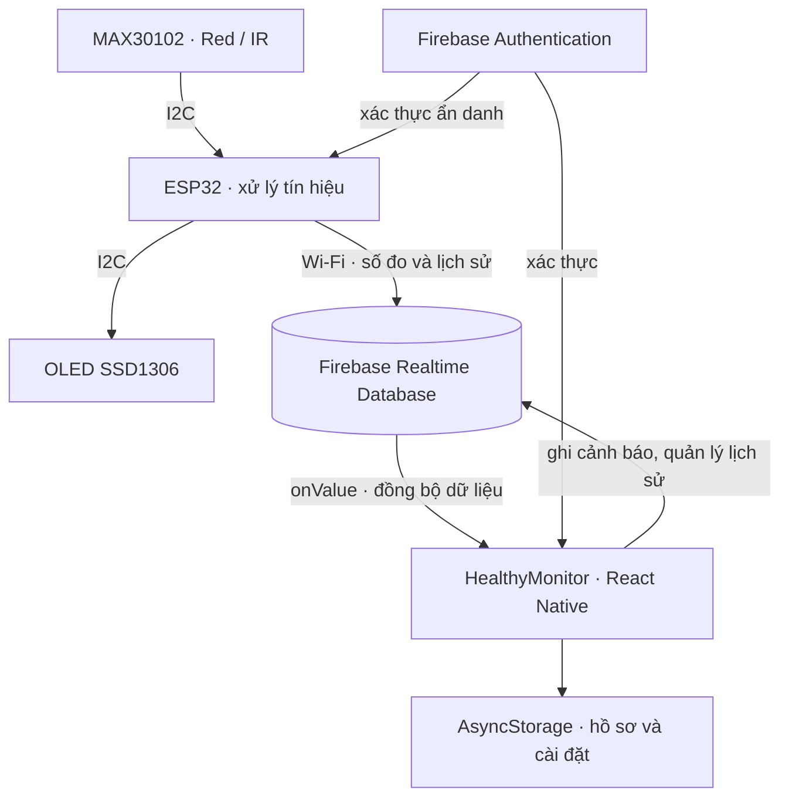

# PPG Health Monitoring System

Hệ thống nghiên cứu và thử nghiệm theo dõi **nhịp tim (BPM)**, **độ bão hòa oxy ngoại vi (SpO₂)** bằng ESP32 và MAX30102, đồng bộ dữ liệu qua Firebase và hiển thị trên ứng dụng HealthyMonitor. Repository đồng thời cung cấp pipeline huấn luyện mô hình **CNN–LSTM ước lượng BPM từ PPG một kênh**, xuất trọng số FP32 và thực thi suy luận bằng **Pure C**.

**Trạng thái tích hợp:** firmware và ứng dụng trao đổi dữ liệu qua Firebase Realtime Database. Nhánh AI/Pure C hiện chạy độc lập trên máy tính hoặc môi trường notebook; chưa được gọi từ firmware ESP32 hay ứng dụng. BPM/SpO₂ trong luồng đo trực tiếp hiện do thuật toán xử lý tín hiệu của firmware tính toán. Mô hình AI chỉ dự đoán BPM.

Đây là dự án phục vụ học tập, nghiên cứu và trình diễn kỹ thuật. Kết quả AI đi kèm được đánh giá trên dữ liệu tổng hợp; repository chưa cung cấp bằng chứng kiểm định lâm sàng hoặc benchmark AI trên ESP32.

## Mục lục

- [1. Thành phần và cấu trúc repository](#repository)
- [2. Kiến trúc và chức năng](#architecture)
- [3. Chạy nhanh Pure C với trọng số có sẵn](#quickstart)
- [4. Chuẩn bị Firebase](#firebase)
- [5. Cài đặt và nạp firmware ESP32](#firmware)
- [6. Cài đặt và chạy HealthyMonitor](#application)
- [7. Dữ liệu và cơ chế cảnh báo](#data-alerts)
- [8. Huấn luyện CNN–LSTM và xuất trọng số C](#ai-pipeline)
- [9. Kết quả thực nghiệm đi kèm](#results)
- [10. Kiểm chứng và khắc phục sự cố](#verification)
- [11. Giới hạn và hướng tích hợp](#limitations)
- [12. Hướng dẫn đọc mã nguồn, nguồn gốc và giấy phép](#references)

<a id="repository"></a>

## 1. Thành phần và cấu trúc repository

Đặt file này tại `ppg-health-monitoring-system/README.md`, cùng cấp với ba thư mục sau:

| Thư mục | Vai trò | Điểm bắt đầu |
| --- | --- | --- |
| [firmwave_esp32/](./firmwave_esp32/) | Thu nhận Red/IR, tính BPM/SpO₂, hiển thị OLED và gửi Firebase | [firmwave_esp32.ino](./firmwave_esp32/firmwave_esp32.ino) |
| [App-HealthyMonitor/](./App-HealthyMonitor/) | Ứng dụng React Native/Expo: xem số đo, lịch sử, báo cáo và cấu hình cảnh báo | [App.tsx](./App-HealthyMonitor/App.tsx), [package.json](./App-HealthyMonitor/package.json) |
| [PPG-PureC-Inference-main/](./PPG-PureC-Inference-main/) | Huấn luyện CNN–LSTM, xuất trọng số, đối chiếu Keras–C và benchmark CPU | [Notebook Kaggle](./PPG-PureC-Inference-main/PPG_Kaggle_Train_Export_PureC.ipynb), [train_export_verify.py](./PPG-PureC-Inference-main/train_export_verify.py) |

Tên `firmwave_esp32` được giữ đúng theo thư mục hiện hữu. Thư mục gốc là nơi tập hợp các thành phần, không có một lệnh duy nhất để khởi chạy toàn bộ hệ thống.

Nhánh AI **đã có checkpoint và trọng số** trong [results/](./PPG-PureC-Inference-main/results/). Có thể chạy suy luận C ngay mà không cần huấn luyện lại, không cần Firebase và không cần phần cứng cảm biến.

<a id="architecture"></a>

## 2. Kiến trúc và chức năng

### 2.1. Luồng đo và hiển thị



Firmware ghi bản đo mới nhất vào `/health_data` với khoảng gửi mục tiêu **1,5 giây**. Khi BPM và SpO₂ hiển thị đều lớn hơn 0, firmware có thể ghi thêm lịch sử vào `/health_history` theo khoảng **15 giây**. Các khoảng này được kiểm tra trong vòng lặp, nên thời gian thực tế còn phụ thuộc thu mẫu và thao tác mạng.

Trong ứng dụng, `healthService` nhận snapshot Firebase; `HeartMonitorController` cập nhật Zustand store và kiểm tra ngưỡng; các màn hình đọc store để hiển thị. Ứng dụng kết nối trực tiếp Firebase SDK, không có backend Node.js trung gian trong bản mã này. Firmware truyền dữ liệu bằng Wi-Fi, không triển khai Bluetooth.

### 2.2. Chức năng hiện có

| Thành phần | Chức năng trong mã nguồn |
| --- | --- |
| Firmware | Đọc Red/IR; lọc EMA, loại DC và phát hiện đỉnh cho BPM; gọi thuật toán Maxim cho SpO₂; lọc trung bình; nhận biết không có ngón tay; hiển thị OLED; ghi dữ liệu Firebase |
| Đăng nhập | Đăng ký/đăng nhập Email–Password và đăng nhập khách qua Firebase Authentication |
| Home | Hiển thị BPM, SpO₂, trạng thái; biểu đồ lưu tối đa 20 điểm cập nhật gần nhất cho mỗi chỉ số |
| History | Xem dữ liệu hôm nay, 7 ngày, 30 ngày; tính trung bình/min/max; chọn điểm trên biểu đồ; xuất và chia sẻ PDF |
| Settings | Lưu hồ sơ và số liên hệ; đặt ngưỡng; chuyển sáng/tối; xóa lịch sử; dọn bản ghi cũ hơn 30 ngày |
| Cảnh báo | Ghi sự kiện vượt ngưỡng, rung điện thoại; xin quyền vị trí và mở ứng dụng nhắn tin/quay số khi có số liên hệ |
| AI/Pure C | Huấn luyện CNN–LSTM; xuất `.bin`/`.h`; kiểm chứng sai khác số học; đo latency CPU; cung cấp ví dụ gọi inference để chuẩn bị tích hợp nhúng |

Mã nguồn có thêm các component như `AlertLog`, `DeviceDiagnosticCard`, `ConnectionStatus` và `SmartConnectionCard`, nhưng chúng **chưa được gắn vào các màn hình đang dùng**. Không nên suy ra rằng mọi component trong `src/components/` đều đã xuất hiện trên giao diện.

<a id="quickstart"></a>

## 3. Chạy nhanh Pure C với trọng số có sẵn

**Yêu cầu:** môi trường Linux/Ubuntu hoặc WSL có `make`, trình biên dịch C hỗ trợ C11 và thư viện toán `libm`. Phần này không yêu cầu Python, TensorFlow hay GPU. Trên Ubuntu/Debian, có thể cài công cụ biên dịch bằng `sudo apt install build-essential` nếu máy chưa có.

Bắt đầu tại thư mục gốc `ppg-health-monitoring-system`:

```bash
cd PPG-PureC-Inference-main
make
./build/ppg_infer results/model_weights.bin results/first_test_window.csv
```

`make` tạo hai sản phẩm:

| Sản phẩm | Mục đích |
| --- | --- |
| `build/ppg_infer` | Chương trình dòng lệnh: đọc trọng số và một cửa sổ PPG, in BPM |
| `build/libppg.so` | Thư viện dùng bởi Python qua `ctypes` để kiểm chứng/benchmark |

Với file mẫu và trọng số đi kèm, kết quả được kiểm tra khi biên soạn README là:

```text
131.44783
```

Đơn vị là BPM; có thể có sai khác rất nhỏ ở chữ số cuối giữa môi trường biên dịch. Đây là dự đoán cho **một cửa sổ thử tổng hợp**, không phải kết quả đo trực tiếp từ cảm biến.

Nếu dùng CSV riêng, file phải có **đúng 1.000 dòng**, mỗi dòng một số hữu hạn, không tiêu đề, không cột thời gian. Các mẫu phải theo thứ tự thời gian và tương ứng **125 Hz**, tức cửa sổ 8 giây. C tự chuẩn hóa min–max; đầu vào là tín hiệu trước bước chuẩn hóa đó.

<a id="firebase"></a>

## 4. Chuẩn bị Firebase

Firmware và ứng dụng phải cùng trỏ đến một Firebase project và cùng **Realtime Database**.

1. Tạo hoặc chọn Firebase project, khởi tạo Realtime Database.
2. Bật phương thức **Anonymous** trong Firebase Authentication để firmware và chế độ khách có thể xác thực. Bật **Email/Password** nếu dùng đăng ký/đăng nhập tài khoản.
3. Đăng ký Web App để lấy đối tượng cấu hình Firebase cho ứng dụng React Native.
4. Điền cấu hình tại các vị trí dưới đây.
5. Thiết lập Security Rules phù hợp với tài khoản/thiết bị được phép truy cập. Repository chưa kèm file Rules có thể triển khai tự động.

| Vị trí | Cấu hình cần đối chiếu |
| --- | --- |
| [firmwave_esp32.ino](./firmwave_esp32/firmwave_esp32.ino) | `WIFI_SSID`, `WIFI_PASSWORD`, `API_KEY`, `DATABASE_URL` |
| [firebase.ts](./App-HealthyMonitor/src/config/firebase.ts) | `apiKey`, `authDomain`, `databaseURL`, `projectId`, `storageBucket`, `messagingSenderId`, `appId` |

Các giá trị hiện được khai báo trực tiếp trong source; chưa có cơ chế tự đọc `.env`. Đổi hoặc tạo `.env` riêng sẽ chưa tác động đến chương trình nếu chưa sửa cách nạp cấu hình.

Quyền cần thiết theo các thao tác đã triển khai:

| Node RTDB | Firmware | Ứng dụng |
| --- | --- | --- |
| `/health_data` | Ghi đè bản đo mới nhất | Đọc realtime |
| `/health_history` | Thêm bản ghi bằng `pushJSON` | Đọc theo thời gian; xóa khi người dùng dùng chức năng quản lý lịch sử |
| `/health_alerts` | Không sử dụng | Ghi cảnh báo; mã đọc cảnh báo có sẵn trong `alertService` |

Thêm chỉ mục `.indexOn: ["timestamp"]` tại node `/health_history` trong Rules để hỗ trợ các truy vấn `orderByChild('timestamp')`. Chỉ mục không cấp quyền đọc/ghi.

**Lưu ý về mô hình dữ liệu:** các node đang dùng chung, chưa chia theo UID hay `deviceId`. Đăng nhập thành công không đồng nghĩa dữ liệu đã được phân quyền riêng cho từng người. Không dùng Rules mở toàn bộ database để khắc phục lỗi quyền truy cập. Ngoài Rules, cần lưu ý vấn đề khởi động controller trước khi đăng nhập được nêu tại [mục 11](#limitations).

Tài liệu đối chiếu: [Anonymous Authentication](https://firebase.google.com/docs/auth/web/anonymous-auth), [Realtime Database Security Rules](https://firebase.google.com/docs/database/security), [chỉ mục dữ liệu](https://firebase.google.com/docs/database/security/indexing-data).

<a id="firmware"></a>

## 5. Cài đặt và nạp firmware ESP32

### 5.1. Phần cứng và kết nối

- Board ESP32 tương thích Arduino, cáp USB có truyền dữ liệu.
- Cảm biến MAX30102 và OLED SSD1306 kích thước 128 × 64.
- Mạng Wi-Fi mà board có thể kết nối để truy cập Firebase.

| Tín hiệu | ESP32 | MAX30102 | OLED SSD1306 |
| --- | --- | --- | --- |
| SDA | GPIO 21 | SDA | SDA |
| SCL | GPIO 22 | SCL | SCL |
| GND | GND chung | GND | GND |

Chọn nguồn theo định mức của breakout đang dùng và bảo đảm mức tín hiệu I²C tương thích ESP32. Hai thiết bị dùng chung bus I²C; địa chỉ OLED trong source là `0x3C`. Chân INT của MAX30102 không được sử dụng trong sketch.

### 5.2. Công cụ và thư viện

Cài Arduino IDE và board package **esp32 by Espressif Systems**, sau đó chuẩn bị:

| Thư viện | Header được sketch sử dụng |
| --- | --- |
| [SparkFun MAX3010x Sensor Library](https://github.com/sparkfun/SparkFun_MAX3010x_Sensor_Library) | `MAX30105.h`, `spo2_algorithm.h` |
| Adafruit GFX Library | `Adafruit_GFX.h` |
| Adafruit SSD1306 | `Adafruit_SSD1306.h` |
| [Firebase Arduino Client Library — mobizt/Firebase-ESP-Client](https://github.com/mobizt/Firebase-ESP-Client) | `Firebase_ESP_Client.h`, `addons/TokenHelper.h`, `addons/RTDBHelper.h` |
| ESP32 Arduino core | `Wire.h`, `WiFi.h` |

Tên lớp `MAX30105` là API của thư viện SparkFun đang được dùng cho cảm biến MAX30102. Thư viện `Firebase-ESP-Client` đã được tác giả đánh dấu deprecated; source hiện vẫn dùng API của thư viện này. Không thay trực tiếp bằng `FirebaseClient` rồi kỳ vọng sketch biên dịch nguyên trạng. Bản mã chưa khóa phiên bản ESP32 core hoặc các thư viện Arduino.

### 5.3. Nạp và quan sát

1. Mở [firmwave_esp32/firmwave_esp32.ino](./firmwave_esp32/firmwave_esp32.ino). Tên sketch hiện đã trùng tên thư mục Arduino.
2. Cấu hình Wi-Fi/Firebase như [mục 4](#firebase).
3. Chọn board và cổng USB đúng với phần cứng, biên dịch rồi nạp sketch.
4. Mở Serial Monitor ở **115200 baud**.
5. Theo dõi kết nối Wi-Fi, kết quả Firebase sign-up và quá trình khởi tạo cảm biến; đặt ngón tay ổn định để theo dõi BPM/SpO₂ trên OLED và RTDB.

Firmware chờ Wi-Fi trong `setup()` trước khi khởi tạo MAX30102. Nếu không kết nối được mạng, chương trình có thể dừng ở màn hình `Connecting WiFi...` và chưa bắt đầu đo.

### 5.4. Tham số và thuật toán đang dùng

| Nhóm | Giá trị trong sketch |
| --- | --- |
| Cấu hình cảm biến | `ledBrightness=60`, `sampleAverage=4`, `ledMode=2`, `sampleRate=100`, `pulseWidth=411`, `adcRange=4096` |
| Cửa sổ tín hiệu | 100 mẫu Red và 100 mẫu IR; mỗi vòng cập nhật 10 mẫu |
| Lọc EMA | `EMA_ALPHA=0.7` |
| Loại DC cho IR | Khởi tạo bằng 50 mẫu; sau đó bám DC bằng hệ số `0.99/0.01` |
| Phát hiện nhịp | Đỉnh cục bộ, ngưỡng thích nghi; khoảng nhịp được chấp nhận lớn hơn 400 ms và nhỏ hơn 1500 ms |
| Lọc hiển thị | Trung bình trên bộ đệm tối đa 5 giá trị |
| Nhận biết không có ngón tay | Mẫu IR cuối cửa sổ nhỏ hơn `10000` |

BPM trong vòng lặp liên tục chủ yếu được cập nhật từ khoảng thời gian giữa các đỉnh IR sau EMA và loại DC. Hàm `maxim_heart_rate_and_oxygen_saturation()` chạy trên bộ đệm Red/IR thô; trong vòng cập nhật, kết quả SpO₂ hợp lệ được sử dụng, còn `tempHR` không được dùng để thay thế BPM của bộ phát hiện đỉnh.

`sampleRate=100` là tham số cấu hình cảm biến, không phải bằng chứng luồng mẫu đầu ra đạt chính xác 100 mẫu/giây sau averaging và xử lý. Cần đo tốc độ thực khi tích hợp với mô hình yêu cầu 125 Hz.

<a id="application"></a>

## 6. Cài đặt và chạy HealthyMonitor

### 6.1. Môi trường

Các phiên bản dưới đây lấy từ [package.json](./App-HealthyMonitor/package.json) và [package-lock.json](./App-HealthyMonitor/package-lock.json):

| Thành phần | Phiên bản khai báo |
| --- | --- |
| Expo | `~57.0.24` |
| React / React Native | `19.2.3` / `0.86.3` |
| TypeScript | `~6.0.3` |
| Firebase JavaScript SDK | `^12.19.0` |
| Zustand | `^5.0.15` |
| React Navigation | Nhóm thư viện v7 |
| AsyncStorage | `2.2.0` |

Dùng Node.js tương thích Expo SDK 57; tài liệu [Expo SDK 57](https://docs.expo.dev/versions/v57.0.0/) nêu mức tối thiểu **Node.js 22.13.x**. Một lựa chọn phù hợp để thiết lập môi trường là Node.js 22.x từ 22.13.0. Giữ lockfile để cài đặt nhất quán.

### 6.2. Cài dependency và khởi động

Sau khi hoàn thành cấu hình Firebase, bắt đầu tại thư mục gốc:

```bash
cd App-HealthyMonitor
npm ci
npm start
```

Mở bằng Expo Go tương thích SDK của dự án hoặc môi trường chạy đã cấu hình. Khi dùng kết nối LAN của Metro, máy tính và điện thoại cần truy cập được nhau trên mạng. Xem [hướng dẫn khởi chạy Expo](https://docs.expo.dev/get-started/start-developing/).

Các script sẵn có, chạy **bên trong `App-HealthyMonitor`**:

| Lệnh | Tác dụng |
| --- | --- |
| `npm start` | Mở Expo development server |
| `npm run android` | Khởi động Expo với tùy chọn mở Android |
| `npm run ios` | Khởi động Expo với tùy chọn mở iOS; iOS Simulator cần môi trường macOS phù hợp |
| `npm run web` | Khởi động chế độ web; các dependency web và tính năng thiết bị cần được kiểm tra riêng |
| `npx tsc --noEmit` | Kiểm tra kiểu TypeScript, không tạo JavaScript đầu ra |

Các script `android`/`ios` gọi `expo start`, không tạo APK/IPA. Repository chưa cung cấp cấu hình EAS Build hoặc thư mục native đã build. `react-dom` và `react-native-web` cũng chưa có trong dependency trực tiếp, nên script web chưa chứng minh bản web có thể chạy đầy đủ nguyên trạng.

### 6.3. Sử dụng ứng dụng

1. Đăng nhập khách hoặc dùng Email–Password đã bật trong Firebase.
2. Mở **Settings**, nhập và lưu `BPM tối đa`, `SpO₂ tối thiểu`. Khi chưa lưu đủ hai ngưỡng, controller không kích hoạt cảnh báo theo ngưỡng.
3. Lưu hồ sơ và số liên hệ nếu muốn thử luồng mở SMS/quay số. Ngưỡng trên app là cài đặt cục bộ, không thay các ngưỡng hiển thị cố định trong firmware.
4. Xem số đo ở **Home**; chọn khoảng thời gian trong **History** và dùng **Xuất PDF** khi đã có dữ liệu.

Profile, ngưỡng, chế độ sáng/tối và tùy chọn dọn dữ liệu được lưu bằng AsyncStorage trên thiết bị. Chúng chưa được lưu theo UID và chưa đồng bộ giữa các điện thoại.

Google Sign-in đang bị vô hiệu hóa trong service. Hàm Apple Sign-in có trong source nhưng chưa đổi credential thành phiên Firebase Auth và chưa được đưa vào màn hình đăng nhập hiện tại.

<a id="data-alerts"></a>

## 7. Dữ liệu và cơ chế cảnh báo

### 7.1. Schema Firebase thực tế

Ví dụ dưới đây minh họa cấu trúc, không phải dữ liệu đo hoặc ngưỡng mặc định:

```json
{
  "health_data": {
    "bpm": 72,
    "spo2": 98,
    "status": "SpO2: Good | HR: Normal",
    "timestamp": 123456
  },
  "health_history": {
    "EXAMPLE_HISTORY_PUSH_ID": {
      "bpm": 72,
      "spo2": 98,
      "timestamp": 1792051200000
    }
  },
  "health_alerts": {
    "EXAMPLE_ALERT_PUSH_ID": {
      "type": "bpm",
      "value": 125,
      "threshold": 120,
      "timestamp": 1792051200000,
      "message": "BPM 125 vượt ngưỡng"
    }
  }
}
```

| Dữ liệu thời gian | Nguồn tạo và ý nghĩa |
| --- | --- |
| `/health_data/timestamp` | Firmware gửi `(int)millis()`: thời gian hoạt động tính từ lúc ESP32 khởi động, **không phải Unix timestamp** |
| `HealthData.timestamp` trong app | `healthService` thay timestamp nhận được bằng `Date.now()` của điện thoại khi callback Firebase chạy |
| `/health_history/.../timestamp` | Firmware gửi `{ ".sv": "timestamp" }` để Firebase ghi thời gian server theo Unix milliseconds |
| `/health_alerts/.../timestamp` | App ghi `Date.now()` khi tạo cảnh báo |

Khi không có ngón tay, firmware gửi `bpm=0`, `spo2=0` và chuỗi trạng thái. Các giá trị 0 là trạng thái chưa có số đo sử dụng được, không được hiểu là kết quả sinh lý.

Firmware chỉ gửi số đo tổng hợp; chưa truyền cửa sổ PPG thô lên Firebase. Schema hiện chưa có `deviceId`, `measurementId`, điểm chất lượng tín hiệu hoặc cờ xác thực thời gian đo.

### 7.2. Lịch sử và quản lý dữ liệu

- **ESP32 ghi lịch sử:** bộ hẹn giờ lưu mỗi 15 giây trong `HeartMonitorController` đã bị comment. `saveHealthHistory()` vẫn tồn tại, nhưng không phải đường ghi định kỳ đang hoạt động.
- **App đọc lịch sử:** truy vấn `orderByChild('timestamp')` và `startAt(...)`, sau đó lọc/hiển thị theo khoảng thời gian đã chọn.
- **Xuất PDF:** màn hình `HistoryScreen` tự tạo HTML và gọi `expo-print`/`expo-sharing`; `reportService.ts` là một triển khai riêng chưa được màn hình này gọi.
- **Dọn dữ liệu:** nút tối ưu xóa lịch sử cũ hơn 30 ngày; đây là xóa bản ghi, không nén dữ liệu. Tùy chọn tự động dọn được thực hiện khi controller khởi động, không phải tác vụ lịch chạy trên server.
- **Xóa toàn bộ:** thao tác hiện xóa node `/health_history` dùng chung, không xóa toàn bộ Firebase project và không xóa `/health_alerts`.

### 7.3. Cảnh báo và SOS

Controller kiểm tra khi đã có ngưỡng và cả BPM/SpO₂ đều lớn hơn 0:

| Điều kiện | Hành vi |
| --- | --- |
| `bpm > maxBpm` | Ghi cảnh báo loại `bpm` |
| `spo2 < minSpo2` | Ghi cảnh báo loại `spo2` |
| Chuyển vào một điều kiện vượt ngưỡng mới | Rung điện thoại và gọi chuỗi SOS |
| Chỉ số trở lại trong ngưỡng | Reset cờ cảnh báo tương ứng để nhận lần vượt ngưỡng sau |

Khi đã lưu số liên hệ, chuỗi SOS xin quyền vị trí ở foreground, cố gắng lấy GPS và chuẩn bị nội dung SMS. Sau đó mã lên lịch mở URI `sms:` sau khoảng 0,5 giây và `tel:` sau khoảng 2 giây. Các khoảng trễ này được đặt **sau bước xử lý vị trí**.

**Hành vi thực tế là mở trình soạn tin và màn hình quay số.** Mã không có xác nhận SMS đã được gửi hoặc cuộc gọi đã kết nối; kết quả còn phụ thuộc hệ điều hành và thao tác người dùng. Repository chưa có dịch vụ nền bảo đảm cảnh báo khi app bị tắt.

Phần giao diện có vùng cảnh báo gần ngưỡng và tình huống BPM thấp hơn 60. Đây là logic hiển thị trong source; controller hiện chỉ kích hoạt SOS theo `maxBpm` và `minSpo2`, chưa có ngưỡng SOS riêng cho nhịp tim thấp hoặc điều kiện duy trì vượt ngưỡng nhiều giây.

<a id="ai-pipeline"></a>

## 8. Huấn luyện CNN–LSTM và xuất trọng số C

### 8.1. Đầu vào, dữ liệu và kiến trúc

Nhánh này nhận một cửa sổ **1.000 mẫu PPG, một kênh, 125 Hz**, chuẩn hóa từng cửa sổ rồi dự đoán một giá trị BPM. Không có đầu ra SpO₂ hoặc bộ phân loại bệnh.

Hai chế độ dữ liệu được triển khai trong [data_pipeline.py](./PPG-PureC-Inference-main/data_pipeline.py):

| Chế độ | Dữ liệu và cách chia |
| --- | --- |
| `synthetic` | Tạo tín hiệu bằng các thành phần điều hòa, biến thiên nền, nhiễu Gaussian và motion artifact; nhãn BPM là tham số sinh tín hiệu; chia 70%/15%/15% theo các mô phỏng độc lập |
| `real_npz` | Nhận dữ liệu do người dùng chuẩn bị; yêu cầu ít nhất 5 người; chia train/validation/test độc lập theo `subject_id` |

Pipeline tổng hợp gán motion artifact theo xác suất 20%, không cố định chính xác 8.000/2.000. Manifest đi kèm ghi tỷ lệ `0.2034`, tương ứng **2.034 cửa sổ có motion artifact trong 10.000 cửa sổ**. Chế độ này không có người tham gia thật; `subject_id` trong test vectors là mã mô phỏng. Không mô tả tập kết quả này là kiểm thử trên BIDMC/ICU hoặc dữ liệu lâm sàng.

Với `real_npz`, file cần các trường:

| Trường | Định dạng |
| --- | --- |
| `X` | Mảng số thực hữu hạn `[N, 1000]` hoặc `[N, 1000, 1]` |
| `y_bpm` | Nhãn BPM tham chiếu hợp lệ, shape `[N]` |
| `subject_id` | Mã người tương ứng mỗi cửa sổ, shape `[N]`; cùng người phải dùng cùng ID |
| `fs_hz` | Giá trị scalar `125` |

Cần resample và căn chỉnh tín hiệu/nhãn trước khi tạo cửa sổ NPZ. Adapter không tự tải dữ liệu thực hoặc tự suy ra nhãn tham chiếu.

Kiến trúc từ [model.py](./PPG-PureC-Inference-main/model.py), bỏ chiều batch:

| Khối | Cấu hình | Kích thước đầu ra |
| --- | --- | --- |
| Input | PPG một kênh; chuẩn hóa min–max trước khi vào mạng | `1000 × 1` |
| CNN 1 | Conv1D(16, k=7, SAME, ReLU) → BN → MaxPool(2) | `500 × 16` |
| CNN 2 | Conv1D(32, k=5, SAME, ReLU) → BN → MaxPool(2) | `250 × 32` |
| CNN 3 | Conv1D(64, k=3, SAME, ReLU) → BN → MaxPool(2) | `125 × 64` |
| LSTM 1 | 32 units, `return_sequences=True`; Dropout(0.2) | `125 × 32` |
| LSTM 2 | 16 units, lấy trạng thái cuối | `16` |
| Dense | 32 units, ReLU; Dropout(0.2) | `32` |
| Output | Dense(1), linear | `1 BPM` |

### 8.2. Huấn luyện trên Kaggle

1. Import [PPG_Kaggle_Train_Export_PureC.ipynb](./PPG-PureC-Inference-main/PPG_Kaggle_Train_Export_PureC.ipynb) vào Kaggle.
2. Chọn môi trường có TensorFlow, NumPy, C compiler và `make`; có thể bật GPU cho training.
3. Kiểm tra cell cấu hình: mặc định `MODE='synthetic'`, 10.000 cửa sổ, tối đa 80 epochs, batch 64, seed 42, tolerance 0,05 BPM và 300 lượt benchmark.
4. Chạy các cell theo thứ tự. Notebook giải nén source vào `/kaggle/working/ppg_c_project`, huấn luyện, xuất trọng số, kiểm chứng và benchmark.
5. Xem kết quả trong `/kaggle/working/ppg_c_project/results/` và tải `/kaggle/working/PPG_Kaggle_Result.zip`.

Notebook có source đóng gói sẵn nên không cần tải source từ GitHub lúc chạy. Bản source nhúng khớp với các file Python/C đi kèm tại thời điểm kiểm tra; nếu sửa file bên ngoài notebook, payload nhúng sẽ không tự cập nhật.

### 8.3. Huấn luyện bằng dòng lệnh

Yêu cầu Python phù hợp với các dependency trong [requirements.txt](./PPG-PureC-Inference-main/requirements.txt): `tensorflow>=2.16,<2.22`, `numpy>=1.26,<3`. File kiểm thử phát triển ghi môi trường Python 3.12/TensorFlow 2.20.0; thông tin môi trường của bộ kết quả đầy đủ nằm trong `benchmark_report.json`.

Bắt đầu tại thư mục gốc; lệnh dưới đây ghi kết quả vào `results_retrained` để giữ bộ kết quả đi kèm:

```bash
cd PPG-PureC-Inference-main
python3 -m venv .venv
source .venv/bin/activate
python -m pip install -r requirements.txt
python train_export_verify.py \
  --mode synthetic \
  --n 10000 \
  --epochs 80 \
  --batch 64 \
  --seed 42 \
  --tolerance 0.05 \
  --benchmark-iters 300 \
  --outdir results_retrained
```

Nếu đã có môi trường Python hoạt động, không cần tạo lại venv. Trên Kaggle, notebook dùng TensorFlow đã cài sẵn và không yêu cầu thay wheel GPU bằng `tensorflow-cpu`.

Với dữ liệu thật, chạy trong cùng thư mục và môi trường:

```bash
python train_export_verify.py \
  --mode real_npz \
  --data-path /duong/dan/real_ppg.npz \
  --epochs 80 \
  --outdir results_real
```

Thay đường dẫn NPZ bằng file thực tế. Kết quả từ lần huấn luyện mới không được mặc định xem là trùng bộ số liệu đã lưu.

### 8.4. Xuất trọng số và thực thi C

Pipeline dùng Adam (`learning_rate=1e-3`), Huber loss và validation MAE để chọn checkpoint. `EarlyStopping` có patience 15; `ReduceLROnPlateau` có patience 7, factor 0.5, learning rate tối thiểu `1e-6`. File checkpoint tốt nhất được nạp lại trước khi xuất trọng số.

Engine C triển khai Conv1D **SAME**, ReLU, Batch Normalization dạng affine, MaxPool, hai LSTM và Dense. Thứ tự là **Conv → ReLU → BN → Pool**. Dropout không hoạt động khi suy luận. Chuẩn hóa đầu vào là `(x-min)/(max-min+1e-8)`, tính phần chuẩn hóa bằng float64 rồi chuyển FP32 để thống nhất với phía Python.

- [c/ppg.c](./PPG-PureC-Inference-main/c/ppg.c): phần tính toán, không cấp phát heap trong `ppg_infer()`; reset trạng thái LSTM mỗi cửa sổ.
- [c/ppg_io.c](./PPG-PureC-Inference-main/c/ppg_io.c): nạp file `.bin`, kiểm tra header, độ dài, CRC32 và giá trị hữu hạn.
- [export_weights.py](./PPG-PureC-Inference-main/export_weights.py): chuyển checkpoint thành binary/header và manifest mô tả tensor.
- [c/embedded_example.c](./PPG-PureC-Inference-main/c/embedded_example.c): ví dụ gọi inference với `static const ppg_model` và workspace cấp một lần.

C chỉ cần C11 và `libm` ở runtime; TensorFlow phục vụ huấn luyện và kiểm chứng phía Python. Pipeline hiện xuất **FP32 `.bin` và `.h`**, chưa có bước tạo `.tflite`, INT8 hoặc FP16 trong luồng thực thi này.

<a id="results"></a>

## 9. Kết quả thực nghiệm đi kèm

### 9.1. Độ chính xác dự đoán và sai khác số học

Nguồn: [numerical_report.json](./PPG-PureC-Inference-main/results/numerical_report.json), [split_manifest.json](./PPG-PureC-Inference-main/results/split_manifest.json) và [predictions.csv](./PPG-PureC-Inference-main/results/predictions.csv).

Tập tổng hợp gồm **7.000 train / 1.500 validation / 1.500 test**. Cùng checkpoint và cùng 1.500 cửa sổ test được dùng để so sánh:

| Chỉ số | Keras | Pure C |
| --- | ---: | ---: |
| MAE so với nhãn (BPM) | 0,830377 | 0,830376 |
| RMSE so với nhãn (BPM) | 1,036848 | 1,036847 |
| P95 sai số tuyệt đối so với nhãn (BPM) | 2,079162 | 2,079162 |
| Accuracy@5 BPM | 100% | 100% |

`Accuracy@5 BPM` ở đây là tỷ lệ cửa sổ có `abs(prediction - label) ≤ 5 BPM`, không phải accuracy của bài toán phân loại. Các tỷ lệ trên chỉ áp dụng cho tập tổng hợp đi kèm.

| Đối chiếu triển khai C–Keras | Giá trị |
| --- | ---: |
| Sai khác tuyệt đối lớn nhất | `0.000030517578125 BPM` |
| Sai khác tuyệt đối trung bình | `0.00000438690185546875 BPM` |
| P95 sai khác tuyệt đối | `0.0000152587890625 BPM` |
| Ngưỡng chấp nhận trong pipeline | `0.05 BPM` |
| Trạng thái ghi trong báo cáo | `pass: true` |

Sai khác C–Keras đánh giá mức khớp của hai triển khai. MAE/RMSE đánh giá dự đoán so với nhãn. Hai nhóm chỉ số có mục đích khác nhau; khớp số học không chứng minh mô hình đã chính xác trên PPG người thật.

### 9.2. Latency CPU

Nguồn: [benchmark_report.json](./PPG-PureC-Inference-main/results/benchmark_report.json) và [timings_ms.csv](./PPG-PureC-Inference-main/results/timings_ms.csv).

Báo cáo ghi CPU Intel Xeon 2,00 GHz, 4 logical CPUs; TensorFlow 2.20.0, NumPy 2.1.3, Python 3.13.15; GCC 13.3.0. Inference chạy trên CPU, batch 1, TensorFlow intra/inter-op đều 1 thread, warm-up 20 lượt và đo 300 lượt, xen kẽ thứ tự hai đường gọi.

| Latency | Keras | Pure C |
| --- | ---: | ---: |
| Trung bình (ms/cửa sổ) | 5,111991 | 1,683370 |
| P50 (ms/cửa sổ) | 5,078751 | 1,662722 |
| P95 (ms/cửa sổ) | 5,457444 | 1,951675 |

Tỷ lệ latency P50 Keras/C là khoảng **3,05× trong phép đo này**. Cả hai đường đo đều bao gồm chuẩn hóa từng cửa sổ và chi phí gọi từ Python; phía C dùng `ctypes`, phía Keras dùng `tf.function` và lấy kết quả bằng `.numpy()`. Nạp trọng số, biên dịch và warm-up không nằm trong phần đo. Đây là số liệu đã lưu, không phải benchmark ESP32 hoặc kết quả đo mới khi viết README.

### 9.3. Kích thước mô hình và workspace

| Thành phần | Kích thước |
| --- | ---: |
| Tổng tham số Keras | 25.505 |
| Số float FP32 sau chuyển BN thành affine | 25.281 |
| Payload trọng số / `ppg_model` | 101.124 bytes, khoảng 98,75 KiB |
| File `model_weights.bin` có header 24 bytes | 101.148 bytes |
| `ppg_workspace` | 69.536 bytes, khoảng 67,91 KiB |

Các kích thước cấu trúc trên **không phải peak RAM/RSS** của tiến trình. Chưa bao gồm buffer đầu vào của bên gọi, stack, sensor driver, Wi-Fi, Firebase hoặc RTOS. Vị trí lưu trọng số trong Flash/RAM trên MCU cần xác nhận bằng cấu hình build và linker map thực tế.

### 9.4. Các file phục vụ tái lập

Tất cả đường dẫn trong bảng nằm dưới [PPG-PureC-Inference-main/results/](./PPG-PureC-Inference-main/results/).

| File | Nội dung |
| --- | --- |
| `best_model.keras` | Checkpoint tốt nhất được chọn theo validation MAE |
| `model_weights.bin`, `model_weights.h` | Trọng số cho host loader và ví dụ tích hợp trực tiếp vào C |
| `weights_manifest.json` | Layout tensor, định dạng, preprocessing và SHA-256 của binary |
| `split_manifest.json`, `split_indices.npz` | Nguồn dữ liệu, seed và chỉ số phân chia tập |
| `test_vectors.npz` | Toàn bộ 1.500 cửa sổ test, nhãn và dự đoán đã lưu |
| `first_test_window.csv` | Cửa sổ đầu tiên để chạy CLI C |
| `predictions.csv`, `numerical_report.json` | Dự đoán từng cửa sổ và chỉ số tổng hợp |
| `timings_ms.csv`, `benchmark_report.json` | 300 lượt timing và mô tả môi trường/phạm vi đo |
| `history.json` | Loss, MAE và learning rate của quá trình huấn luyện |

<a id="verification"></a>

## 10. Kiểm chứng và khắc phục sự cố

### 10.1. Kiểm chứng Pure C

Khi đã cài dependency Python, chạy trong `PPG-PureC-Inference-main`:

```bash
python tests/test_equivalence.py
```

Bộ test kiểm tra C–Keras toàn mạng với BN gamma âm, reset trạng thái, từ chối NaN/Inf, phát hiện trọng số hỏng, split không trùng người và biên dịch header sinh ra. [development_validation.json](./PPG-PureC-Inference-main/development_validation.json) ghi kết quả kiểm thử phát triển trước đó; không được nhầm với báo cáo accuracy/latency của checkpoint đầy đủ trong `results/`.

**Phạm vi kiểm tra khi biên soạn README:** đã build bằng Makefile, chạy CLI mẫu, đối chiếu SHA-256/CRC32 trọng số, kiểm tra số lượng và tính tách biệt của split, và chạy lại C trên toàn bộ 1.500 cửa sổ. Dự đoán C khớp các giá trị C đã lưu và đạt tolerance khi so với dự đoán Keras đã lưu. Chưa chạy lại TensorFlow/unit test, chưa build/chạy ứng dụng, chưa nạp board và chưa kiểm thử Firebase trực tiếp trong lần kiểm tra này.

### 10.2. Trình tự thử toàn hệ thống

1. Kiểm tra OLED và cảm biến khởi tạo thành công qua Serial Monitor.
2. Kiểm tra `/health_data` thay đổi; đối chiếu BPM/SpO₂ hiển thị với giá trị firmware gửi.
3. Kiểm tra `/health_history` nhận thêm bản ghi khi cả hai chỉ số lớn hơn 0, kể cả khi chưa mở app.
4. Đăng nhập app và kiểm tra Home, History, bộ lọc thời gian, PDF.
5. Trong môi trường thử, kiểm tra luồng vượt ngưỡng bằng dữ liệu kiểm soát và số liên hệ thử nghiệm; xác nhận việc ghi cảnh báo và mở SMS/quay số.
6. Thử tháo ngón tay, ngắt mạng, đăng xuất/đăng nhập lại để quan sát các giới hạn vòng đời và độ mới dữ liệu.

### 10.3. Lỗi thường gặp

| Hiện tượng | Điểm cần kiểm tra |
| --- | --- |
| `make: Nothing to be done for 'all'` | Thông báo bình thường khi sản phẩm build đã cập nhật; tiếp tục chạy `./build/ppg_infer ...` |
| `Weight load failed (-2)` | File trọng số không mở được; chạy từ đúng thư mục nhánh AI hoặc dùng đường dẫn tuyệt đối |
| Lỗi loader `-3`, `-4`, `-5`, `-6` | Lần lượt kiểm tra header/kiến trúc, độ dài file, CRC32 và giá trị trọng số; không trộn trọng số của kiến trúc khác |
| `Need exactly 1000 samples`, `Extra input samples`, `Invalid sample` | CSV phải đúng 1.000 dòng số hữu hạn, không header hoặc cột phụ |
| Không tìm thấy `MAX30105.h` / `spo2_algorithm.h` | Cài đúng SparkFun MAX3010x Sensor Library |
| Không tìm thấy `Firebase_ESP_Client.h` | Cài đúng thư viện Firebase-ESP-Client dùng bởi sketch |
| `MAX30105 was not found!` hoặc OLED không hoạt động | Kiểm tra nguồn, GND chung, SDA/SCL, địa chỉ OLED `0x3C` và phần cứng kết nối |
| Dừng ở `Connecting WiFi...` | Kiểm tra SSID, mật khẩu và mạng; sketch chờ kết nối trước khi khởi tạo sensor |
| Firebase sign-up thất bại | Kiểm tra Anonymous Auth, API key và cấu hình project |
| `permission_denied` trên app/firmware | Kiểm tra danh tính xác thực, đúng RTDB URL và Rules tại node liên quan; lưu ý controller chạy trước khi đăng nhập |
| Đăng nhập lại nhưng Home không cập nhật | Controller đã bị `stop()` khi đăng xuất và chưa được `start()` lại theo auth state; cần xử lý vòng đời này trong mã |
| App báo ONLINE nhưng ESP32 không còn gửi | Dashboard chưa kiểm tra heartbeat/độ cũ của dữ liệu; không dùng badge này để kết luận thiết bị đang đo |
| `npm ci` không thành công | Đối chiếu Node/npm, mạng và lỗi cụ thể; giữ `package.json`/lockfile đồng bộ |
| Không tạo/chia sẻ PDF hoặc không mở SMS/quay số | Kiểm tra môi trường thiết bị và hỗ trợ API; không xem kết quả chạy web là kiểm thử đầy đủ tính năng native |

<a id="limitations"></a>

## 11. Giới hạn và hướng tích hợp

### 11.1. Những điểm cần biết khi sử dụng bản mã này

- **Vòng đời ứng dụng:** `App.tsx` gọi `start()` trước khi Firebase Auth được xác định. Subscription có thể gặp lỗi quyền truy cập và chưa có cơ chế khởi động lại theo auth state. Sau `stop()` khi đăng xuất, luồng đăng nhập lại chưa gọi `start()`. Ngoài ra, guard của `start()` dựa vào `saveInterval`, trong khi đoạn tạo interval đã bị comment, nên guard chưa ngăn được việc đăng ký nhiều lần.
- **Độ mới dữ liệu:** `healthService` đóng dấu giờ nhận bằng thời gian điện thoại; snapshot cũ có thể nhận dấu giờ mới khi app kết nối. Dashboard dùng cờ store làm trạng thái kết nối, chưa xác nhận ESP32 vẫn đang gửi số đo mới.
- **Chất lượng phép đo:** firmware chưa có cơ chế đánh giá chất lượng tín hiệu đầy đủ; một số giá trị/cờ hợp lệ có thể được giữ từ vòng đo trước. Cửa sổ hằng hoặc tín hiệu kém vẫn có thể tạo đầu ra hữu hạn ở mô hình AI; đầu ra hữu hạn không đồng nghĩa phép đo hợp lệ.
- **Phân tách người dùng:** RTDB paths và dữ liệu AsyncStorage chưa được chia theo UID. Chức năng xóa lịch sử tác động đến node lịch sử chung.
- **Cảnh báo:** chưa có kiểm tra độ mới, thời gian duy trì vượt ngưỡng hoặc dịch vụ nền bảo đảm SOS. Mở ứng dụng nhắn tin/gọi điện không xác nhận đã liên lạc thành công.
- **Cấu hình trong source:** sketch đang chứa SSID/mật khẩu Wi-Fi và cấu hình Firebase. Trước khi công khai, cần thay thông tin riêng bằng giá trị mẫu; nếu mật khẩu đã lộ thì đổi mật khẩu. API key của Firebase client không thay thế Security Rules. README này không sao chép các giá trị cấu hình riêng đó.
- **Kết quả AI:** hiện chứng minh khả năng tái lập suy luận trên dữ liệu tổng hợp và host CPU. Chưa có kết quả AI trên PPG cảm biến thật, MCU, hoặc bài toán SpO₂.

### 11.2. Các bước cần bổ sung để chạy AI trên ESP32

1. Xác minh tần số mẫu thực tế sau averaging, FIFO và truyền mạng; chuẩn bị luồng PPG đúng 125 Hz hoặc resample có kiểm soát.
2. Tạo buffer cửa sổ 1.000 mẫu theo thứ tự thời gian. Buffer 100 mẫu của firmware hiện tại chưa đáp ứng input mô hình.
3. Bổ sung kiểm tra tiếp xúc, chất lượng tín hiệu và thời gian đo trước khi gọi inference.
4. Tích hợp `c/ppg.c`, `c/ppg.h`, `model_weights.h` theo ví dụ nhúng. Bố trí workspace khoảng 67,91 KiB ngoài task stack và xác nhận vị trí trọng số qua linker map.
5. Đo latency, RAM/stack và Flash trên board cùng lúc với sensor, OLED, Wi-Fi và Firebase.
6. Đánh giá mô hình với dữ liệu thực có nhãn tham chiếu và split theo người; sau đó mới quyết định cách đưa đầu ra AI vào schema và logic ứng dụng.

Các bước trên là công việc tích hợp tiếp theo, chưa phải chức năng đã hoàn thành trong firmware hiện tại.

<a id="references"></a>

## 12. Hướng dẫn đọc mã nguồn, nguồn gốc và giấy phép

### 12.1. Điểm vào theo mục tiêu tìm hiểu

| Muốn tìm hiểu | File nên đọc |
| --- | --- |
| Thu nhận và xử lý tín hiệu cảm biến | [firmwave_esp32.ino](./firmwave_esp32/firmwave_esp32.ino) |
| Luồng dữ liệu từ Firebase đến giao diện | [healthService.ts](./App-HealthyMonitor/src/services/healthService.ts) → [HeartMonitorController.ts](./App-HealthyMonitor/src/services/HeartMonitorController.ts) → [useHealthStore.ts](./App-HealthyMonitor/src/store/useHealthStore.ts) → [DashboardScreen.tsx](./App-HealthyMonitor/src/screens/DashboardScreen.tsx) |
| Đăng nhập và điều hướng | [authService.ts](./App-HealthyMonitor/src/services/authService.ts), [AppNavigator.tsx](./App-HealthyMonitor/src/navigation/AppNavigator.tsx) |
| Lịch sử và báo cáo PDF | [historyService.ts](./App-HealthyMonitor/src/services/historyService.ts), [HistoryScreen.tsx](./App-HealthyMonitor/src/screens/HistoryScreen.tsx) |
| Cấu hình và cảnh báo | [settingsService.ts](./App-HealthyMonitor/src/services/settingsService.ts), [alertService.ts](./App-HealthyMonitor/src/services/alertService.ts), [HeartMonitorController.ts](./App-HealthyMonitor/src/services/HeartMonitorController.ts) |
| Dữ liệu và kiến trúc AI | [data_pipeline.py](./PPG-PureC-Inference-main/data_pipeline.py), [model.py](./PPG-PureC-Inference-main/model.py) |
| Huấn luyện, xuất checkpoint và benchmark | [train_export_verify.py](./PPG-PureC-Inference-main/train_export_verify.py), [export_weights.py](./PPG-PureC-Inference-main/export_weights.py) |
| API và phép toán suy luận C | [ppg.h](./PPG-PureC-Inference-main/c/ppg.h), [ppg.c](./PPG-PureC-Inference-main/c/ppg.c), [c_bridge.py](./PPG-PureC-Inference-main/c_bridge.py) |
| Kiểm chứng hai triển khai | [test_equivalence.py](./PPG-PureC-Inference-main/tests/test_equivalence.py), [numerical_report.json](./PPG-PureC-Inference-main/results/numerical_report.json) |

### 12.2. Tài liệu thành phần

- [README ứng dụng HealthyMonitor](./App-HealthyMonitor/README.md).
- [README firmware](./firmwave_esp32/README.md).
- [README AI/Pure C](./PPG-PureC-Inference-main/README.md) và [README_VI](./PPG-PureC-Inference-main/README_VI.md).

Một số mô tả trong README thành phần thuộc bản đóng gói trước: tài liệu firmware còn nhắc `code_max30102.txt`, trong khi file hiện tại là `firmwave_esp32.ino`; README AI còn dòng chưa có trọng số đã huấn luyện, trong khi repository này đã chứa `results/`. Hướng dẫn ở README gốc này dùng tên file và bộ kết quả thực tế của bản mã đang đi kèm.

### 12.3. Nguồn gốc và giấy phép

Kiến trúc AI kế thừa dự án [RAj5517/ppg_heart_rate_estimator](https://github.com/RAj5517/ppg_heart_rate_estimator), liên quan model [raj5517/ppg-heart-rate-estimator](https://huggingface.co/raj5517/ppg-heart-rate-estimator). [upstream_provenance.json](./PPG-PureC-Inference-main/upstream_provenance.json) ghi commit tham chiếu `649e3f2e92ab82738428cfd7d06d1187669442ab` và checksum của các file nguồn. Mã tham chiếu gốc được giữ tại [upstream_reference/](./PPG-PureC-Inference-main/upstream_reference/).

Pipeline hiện huấn luyện checkpoint riêng và xuất checkpoint đó cho C; không mặc định tải pretrained weights từ Hugging Face.

| Phạm vi | Thông tin giấy phép hiện có |
| --- | --- |
| Nhánh ứng dụng | [LICENSE](./App-HealthyMonitor/LICENSE): MIT notice của Expo / 650 Industries |
| Nguồn AI upstream | [LICENSE_UPSTREAM](./PPG-PureC-Inference-main/LICENSE_UPSTREAM): MIT notice của Sayanendu Pramanik |
| Thư mục gốc và firmware | Chưa có file LICENSE riêng xác định giấy phép chung cho toàn bộ phần này |

Giữ các thông báo bản quyền nguồn khi sử dụng và phân phối lại. README không tự gán một giấy phép chung cho toàn repository.

Khi dẫn dự án trong báo cáo, nên dẫn phiên bản commit/tag cụ thể và liên kết đến file nguồn hoặc kết quả tương ứng. Ví dụ: kiến trúc dẫn `model.py`, thiết kế C dẫn `c/ppg.c`, còn số liệu dẫn `results/numerical_report.json` và `results/benchmark_report.json` của cùng phiên bản.
