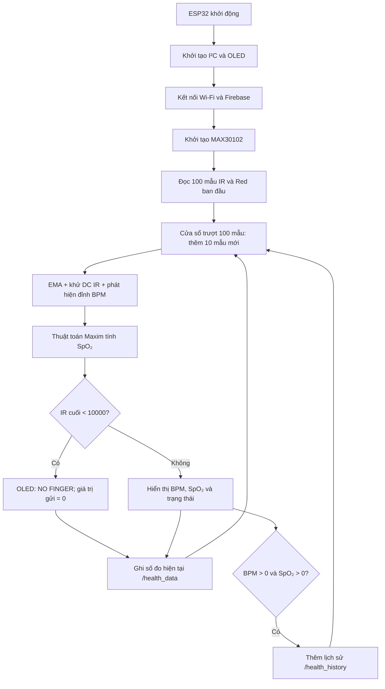

# ESP32 Health Monitor — MAX30102, OLED & Firebase RTDB

Hệ thống giám sát **nhịp tim (BPM)** và **độ bão hòa oxy trong máu ước tính (SpO₂)** sử dụng **ESP32** và cảm biến quang học **MAX30102**. Thiết bị xử lý tín hiệu PPG (photoplethysmography) tại chỗ, hiển thị thông số trên màn hình **OLED SSD1306 128 × 64** và gửi dữ liệu qua Wi-Fi đến **Firebase Realtime Database**.


## Mục lục

1. [Tính năng đã triển khai](#1-tính-năng-đã-triển-khai)
2. [Kiến trúc và luồng xử lý](#2-kiến-trúc-và-luồng-xử-lý)
3. [Phần cứng và sơ đồ nối dây](#3-phần-cứng-và-sơ-đồ-nối-dây)
4. [Môi trường phát triển và thư viện](#4-môi-trường-phát-triển-và-thư-viện)
5. [Cách chuẩn bị và chạy firmware](#5-cách-chuẩn-bị-và-chạy-firmware)
6. [Thuật toán và các tham số](#6-thuật-toán-và-các-tham-số)
7. [Cấu trúc dữ liệu Firebase](#7-cấu-trúc-dữ-liệu-firebase)
8. [Trạng thái hiển thị](#8-trạng-thái-hiển-thị)
9. [Bảo mật và quyền riêng tư](#9-bảo-mật-và-quyền-riêng-tư)
10. [Giới hạn và các điểm cần lưu ý](#10-giới-hạn-và-các-điểm-cần-lưu-ý)
11. [Khắc phục lỗi và kiểm thử thủ công](#11-khắc-phục-lỗi-và-kiểm-thử-thủ-công)
12. [Nguồn tham khảo](#12-nguồn-tham-khảo)

## 1. Tính năng đã triển khai

- **Thu nhận PPG hai kênh:** đọc tín hiệu LED **Red** và **IR** từ MAX30102 thông qua giao tiếp I²C.
- **Ước lượng nhịp tim (BPM):** dùng bộ lọc EMA, loại bỏ thành phần DC của kênh IR, phát hiện đỉnh và tính khoảng thời gian giữa các nhịp. Giá trị nhịp tim được làm mượt bằng trung bình trượt.
- **Ước lượng SpO₂:** gọi `maxim_heart_rate_and_oxygen_saturation()` với bộ đệm mẫu Red/IR, kiểm tra cờ hợp lệ và làm mượt kết quả.
- **Nhận biết không đặt ngón tay:** kiểm tra giá trị IR cuối cùng; hiển thị `NO FINGER` khi thấp hơn ngưỡng cấu hình trong mã.
- **Hiển thị cục bộ:** OLED hiển thị BPM, SpO₂ và trạng thái thu thập/ổn định số đo.
- **Firebase RTDB:** ghi số đo hiện tại định kỳ vào `health_data`; bổ sung một bản ghi lịch sử vào `health_history` khi cả hai giá trị đang hiển thị đều lớn hơn 0.
- **Kết nối Firebase:** sử dụng xác thực ẩn danh (Anonymous Authentication) thông qua thư viện `Firebase_ESP_Client`.

**Chưa thấy trong tệp nguồn:** ứng dụng di động, API/backend trung gian, cơ chế cảnh báo bằng thông báo đẩy, lưu dữ liệu ngoại tuyến hoặc đồng bộ thời gian NTP. Các chức năng đó **không được coi là đã triển khai** trong repository này.

## 2. Kiến trúc và luồng xử lý



- Khi khởi động, chương trình đợi kết nối Wi-Fi, thiết lập Firebase và phát hiện MAX30102 trước khi thu thập mẫu.
- Sau 100 mẫu khởi tạo, mỗi lần xử lý sẽ **giữ lại 90 mẫu cũ và thu nhận 10 mẫu mới**, tạo một cửa sổ trượt dài 100 mẫu.
- Tính toán BPM và SpO₂ thực hiện trên ESP32; Firebase chỉ nhận kết quả đã đóng gói, **không nhận chuỗi PPG thô** trong mã hiện tại.
- Vòng xử lý nằm trong `while (1)` bên trong `loop()`, với `delay(100)` ở cuối mỗi lượt. Vì vậy **thời gian thực tế giữa các lượt không cố định tuyệt đối**: còn phụ thuộc thời gian lấy mẫu và truyền dữ liệu mạng.

## 3. Phần cứng và sơ đồ nối dây

### Thành phần

| Thành phần | Vai trò |
|---|---|
| ESP32 Dev Board | Đọc cảm biến, xử lý số đo và kết nối Wi-Fi |
| MAX30102 | Thu tín hiệu quang học PPG bằng LED Red/IR |
| OLED SSD1306, 128 × 64, I²C | Hiển thị thông số tại thiết bị |
| Dây nối, nguồn USB phù hợp | Kết nối phần cứng và cấp nguồn |

### Kết nối I²C theo mã nguồn

| Tín hiệu | ESP32 | MAX30102 | OLED SSD1306 |
|---|---|---|---|
| SDA | GPIO 21 | SDA | SDA |
| SCL | GPIO 22 | SCL | SCL |
| GND | GND | GND | GND |
| Nguồn | 3V3 hoặc nguồn phù hợp với từng module | VCC/VIN tùy breakout | VCC/VIN tùy breakout |

Hai module chia sẻ cùng bus I²C. Firmware gọi `Wire.begin(21, 22)`; địa chỉ OLED là **`0x3C`**. Thư viện SparkFun sử dụng địa chỉ I²C mặc định **`0x57`** cho họ MAX3010x; đây là mặc định của thư viện, không phải một địa chỉ được viết trực tiếp trong sketch.

> **Lưu ý điện áp:** GPIO của ESP32 dùng logic 3,3 V. Kiểm tra bộ ổn áp, mạch chuyển mức và điện trở kéo lên I²C trên **đúng module đang sử dụng** trước khi cấp nguồn; không mặc định rằng mọi breakout MAX30102/OLED đều chịu được 5 V.

## 4. Môi trường phát triển và thư viện

- **IDE:** Arduino IDE, với board package **ESP32 by Espressif Systems**.
- **Board:** chọn cấu hình board ESP32 tương ứng với phần cứng thực tế.
- **Serial Monitor:** `115200` baud.

| Header trong firmware | Nguồn/thư viện |
|---|---|
| `Wire.h`, `WiFi.h` | Arduino core dành cho ESP32 |
| `MAX30105.h`, `spo2_algorithm.h` | [SparkFun MAX3010x Pulse and Proximity Sensor Library](https://github.com/sparkfun/SparkFun_MAX3010x_Sensor_Library) |
| `Adafruit_GFX.h` | [Adafruit GFX Library](https://github.com/adafruit/Adafruit-GFX-Library) |
| `Adafruit_SSD1306.h` | [Adafruit SSD1306](https://github.com/adafruit/Adafruit_SSD1306) |
| `Firebase_ESP_Client.h`, `addons/TokenHelper.h`, `addons/RTDBHelper.h` | [Firebase ESP Client (Mobizt)](https://github.com/mobizt/Firebase-ESP-Client) |

**Lưu ý về Firebase:** `Firebase_ESP_Client` là **thư viện cũ đã được tác giả đánh dấu ngừng hỗ trợ**. Firmware này dùng API của thư viện cũ, do đó việc cài thư viện `FirebaseClient` mới **không phải phép thay thế trực tiếp** khi vẫn giữ nguyên source code. README không khẳng định đã kiểm thử tương thích với phiên bản thư viện/ESP32 core cụ thể nào.

### Cài đặt

1. Mở **Arduino IDE → Boards Manager** và cài **ESP32 by Espressif Systems**.
2. Mở **Library Manager**, cài thư viện MAX3010x của SparkFun, `Adafruit GFX Library` và `Adafruit SSD1306`.
3. Cài thư viện **Firebase ESP Client** tương thích với các header/API được sử dụng trong firmware. Tải từ nguồn dự án nếu nó không còn xuất hiện trong Library Manager.
4. Xác nhận môi trường có `spo2_algorithm.h` và phần triển khai tương ứng (`spo2_algorithm.cpp`) trong thư viện SparkFun. Kiểm tra cả thư mục `addons` của thư viện Firebase nếu gặp lỗi không tìm thấy header.

## 5. Cách chuẩn bị và chạy firmware

### Cấu trúc tệp được cung cấp

```text
repository/
├── README.md
└── code_max30102.txt     # Mã nguồn gốc, giữ nguyên nội dung
```

Tệp được cung cấp hiện mang đuôi `.txt`. Arduino IDE biên dịch sketch với đuôi `.ino`; do đó, khi chạy cục bộ, có thể tạo **một bản sao không đổi nội dung** của mã nguồn dưới tên sketch hợp lệ. Ví dụ trên Linux:

```bash
mkdir -p ESP32_MAX30102
cp code_max30102.txt ESP32_MAX30102/ESP32_MAX30102.ino
```

Lệnh `cp` chỉ tạo bản sao với tên/đuôi tệp phù hợp; **không sửa byte nào trong tệp `code_max30102.txt` gốc**. File `.ino` tạo ra vẫn chứa các cấu hình riêng tư giống bản gốc: không đăng bản sao đó lên repository public.

### Điều kiện trước khi chạy

1. Kiểm tra nguồn điện và đường nối SDA/SCL của MAX30102, OLED.
2. Đảm bảo ESP32 có thể kết nối tới mạng Wi-Fi đã cấu hình. ESP32 thông dụng sử dụng Wi-Fi **2,4 GHz**.
3. Trong Firebase Console, bảo đảm dự án đã bật **Authentication → Sign-in method → Anonymous**.
4. Đảm bảo Firebase Realtime Database tồn tại, URL đúng với dự án và **Security Rules** cấp quyền đọc/ghi tối thiểu cần thiết cho thiết bị. Không mở toàn bộ database công khai để sửa lỗi kết nối.
5. Chọn đúng board và cổng USB trong Arduino IDE, mở sketch `.ino` đã tạo từ bản sao và **Verify/Upload**.
6. Mở **Serial Monitor ở 115200 baud**, quan sát quá trình kết nối và dữ liệu trên màn hình OLED.

**Trình tự kỳ vọng theo chương trình:** `Connecting WiFi...` → thông báo kết nối Wi-Fi trên Serial → xác thực Firebase → `Init Sensor...` → `Place Finger...` → BPM/SpO₂ (nếu có số đo hợp lệ). Đây là **luồng dự kiến từ mã nguồn**, chưa phải bằng chứng đã chạy thử trên phần cứng.

## 6. Thuật toán và các tham số

### Cấu hình MAX30102

| Tham số | Giá trị trong firmware |
|---|---:|
| `ledBrightness` | `60` |
| `sampleAverage` | `4` |
| `ledMode` | `2` — sử dụng Red và IR |
| `sampleRate` | `100` |
| `pulseWidth` | `411` |
| `adcRange` | `4096` |
| Độ dài bộ đệm Red/IR | `100` mẫu/kênh |
| Số mẫu mới cho mỗi lượt | `10` mẫu/kênh |
| `EMA_ALPHA` | `0.7` |
| `DC_BUFFER_SIZE` | `50` |
| `PEAK_THRESHOLD_ALPHA` | `0.95` |
| `MIN_BEAT_INTERVAL` / `MAX_BEAT_INTERVAL` | `400` / `1500` ms |
| Khoảng BPM được chấp nhận | `40`–`150` BPM |
| `AVG_FILTER_SIZE` | `5` giá trị |
| Ngưỡng phát hiện không có ngón tay | `IR < 10000` |

### Xử lý nhịp tim

**Lọc EMA trên tín hiệu IR:**

```text
EMA[n] = 0.7 × IR[n] + 0.3 × EMA[n−1]
```

Thành phần nền (DC) được ước lượng bằng trung bình tăng dần trong giai đoạn đầu, sau đó cập nhật chậm theo `DC = 0.99 × DC + 0.01 × EMA`. Thành phần xoay chiều được lấy bằng **AC = EMA − DC**.

Hàm `detectBeat()` dùng quan hệ giữa ba mẫu AC liên tiếp để phát hiện cực đại, kết hợp ngưỡng thích nghi và ngưỡng biên độ cố định (`prevSignal > 100`). Khi phát hiện nhịp hợp lệ, firmware tính:

```text
BPM = 60000 / (thời điểm nhịp hiện tại − thời điểm nhịp trước), đơn vị ms
```

Khoảng cách giữa hai nhịp phải **lớn hơn 400 ms và nhỏ hơn 1500 ms**. Kết quả tức thời được kiểm tra miền 40–150 BPM rồi đưa qua bộ trung bình trượt tối đa 5 giá trị trước khi gán cho `heartRate`.

### Xử lý SpO₂

Firmware gọi `maxim_heart_rate_and_oxygen_saturation()` từ thư viện thuật toán Maxim/SparkFun, truyền vào cửa sổ 100 mẫu IR và Red. Chương trình chỉ nhận kết quả SpO₂ mới khi `tempValidSPO2 == 1` và `0 < tempSPO2 <= 100`, sau đó áp dụng trung bình trượt 5 giá trị để làm mượt số hiển thị.

**Phân biệt với thuật toán thư viện:** ở bước khởi tạo, hàm Maxim trả về cả HR và SpO₂. Tuy nhiên trong vòng xử lý liên tục, **BPM được cập nhật theo bộ phát hiện đỉnh IR riêng của firmware**; giá trị HR tạm (`tempHR`) mà hàm Maxim tính lại không được sử dụng để cập nhật BPM.

## 7. Cấu trúc dữ liệu Firebase

Firmware giao tiếp **trực tiếp** với Firebase Realtime Database; không có REST backend độc lập trong tệp nguồn này.

### 7.1. Số đo hiện tại: `/health_data`

Lệnh `Firebase.RTDB.setJSON(&fbdo, "health_data", &json)` **ghi đè nội dung tại node** `health_data` bằng JSON mới. Điều kiện dự kiến: Firebase sẵn sàng, xác thực thành công và đã qua khoảng **1.500 ms** từ lần gửi trước (hoặc đây là lần gửi đầu).

Ví dụ minh họa cấu trúc (không phải dữ liệu đo thật):

```json
{
  "health_data": {
    "bpm": 78,
    "spo2": 97,
    "status": "SpO2: Good | HR: Normal",
    "timestamp": 482319
  }
}
```

| Trường | Kiểu dữ liệu từ sketch | Ý nghĩa |
|---|---|---|
| `bpm` | số nguyên | BPM đang hiển thị; bằng `0` nếu không có số đo được chấp nhận trong lượt hiện tại |
| `spo2` | số nguyên | SpO₂ đang hiển thị; bằng `0` nếu không có số đo được chấp nhận trong lượt hiện tại |
| `status` | chuỗi | Trạng thái ghép từ đánh giá SpO₂ và HR hoặc thông báo không có ngón tay |
| `timestamp` | số nguyên | Giá trị `(int)millis()` tính từ khi ESP32 khởi động, **không phải Unix timestamp** |

Khi phát hiện không có ngón tay, firmware cập nhật `bpm = 0`, `spo2 = 0` và `status = "Không có thiết bị/Ngón tay"` ở lần ghi Firebase tiếp theo.

### 7.2. Lịch sử: `/health_history`

Cứ khoảng **15.000 ms**, firmware thử thêm một bản ghi bằng `Firebase.RTDB.pushJSON()` **chỉ khi** `currentDisplayHR > 0` **và** `currentDisplaySPO2 > 0`. Firebase tạo khóa riêng cho mỗi bản ghi.

Ví dụ minh họa dạng dữ liệu kỳ vọng:

```json
{
  "health_history": {
    "-examplePushKey": {
      "bpm": 78,
      "spo2": 97,
      "timestamp": 1792000000000
    }
  }
}
```

Khác với dữ liệu tức thời, `timestamp` ở lịch sử được thiết lập bằng **Firebase Server Timestamp** (`"timestamp/.sv" = "timestamp"`), nhằm lưu thời điểm tại phía máy chủ. Khóa `-examplePushKey` và các số trong ví dụ chỉ có tính minh họa.

### 7.3. Hai loại timestamp không đồng nhất

| Node | Cách tạo thời gian | Có phải thời gian thực UTC? |
|---|---|---|
| `/health_data` | `(int)millis()` của ESP32 | **Không** — uptime; còn có giới hạn ép kiểu về số nguyên có dấu |
| `/health_history` | Firebase Server Timestamp | **Có** — thời gian epoch tính bằng mili giây do Firebase ghi |

Ứng dụng đọc dữ liệu cần **phân biệt hai đơn vị/ngữ nghĩa này**, không ghép hai trường `timestamp` thành một trục thời gian tuyệt đối khi chưa chuẩn hóa.

## 8. Trạng thái hiển thị

### Phân loại SpO₂ trong firmware

| Giá trị SpO₂ hợp lệ | Chuỗi trạng thái |
|---|---|
| Từ 95 trở lên | `SpO2: Good` |
| Từ 90 đến 94 | `SpO2: Low` |
| Dưới 90 | `SpO2: DANGER` |
| Không có giá trị hợp lệ | `SpO2: Calc...` |

### Phân loại nhịp tim trong firmware

| Nhịp tim hợp lệ | Chuỗi trạng thái |
|---|---|
| 60–100 BPM | `HR: Normal` |
| 101–120 BPM | `HR: High` |
| Trên 120 BPM | `HR: Warn!` |
| 40–59 BPM | `HR: Low` |
| Dưới 40 BPM | `HR: VeryLow` (nhánh có trong mã; ít khả năng đạt đến do bộ lọc BPM 40–150) |
| Không có giá trị hợp lệ | `HR: Calc...` |

**Quan trọng:** nhãn `Status: Normal` ở cuối màn hình OLED được hiển thị khi **hai bộ đệm trung bình BPM và SpO₂ đã được điền đủ**, chứ **không phải kết luận rằng các chỉ số sinh lý đều bình thường**. Các ngưỡng trạng thái trên là logic hiển thị của dự án, **không thay thế ngưỡng chẩn đoán lâm sàng**.

## 9. Bảo mật và quyền riêng tư

**Không nên xuất bản source code hiện tại dưới chế độ public.** Tệp đính kèm có chứa thông tin mạng riêng và định danh/cấu hình Firebase. README cố ý **không sao chép các giá trị đó**.

- Mật khẩu Wi-Fi ghi trực tiếp trong firmware là thông tin nhạy cảm. Nếu đã lộ trong repository công khai, **đổi mật khẩu Wi-Fi**; chỉ xóa ở commit mới sẽ không xóa thông tin đã tồn tại trong lịch sử Git.
- Firebase **Web API Key** thường là định danh cấu hình phía client, không được xem là cơ chế xác thực bí mật thay cho Security Rules. Tuy nhiên vẫn cần kiểm tra **API restrictions**, Authentication và **Firebase RTDB Security Rules** để hạn chế truy cập trái phép.
- Dữ liệu BPM/SpO₂ và lịch sử liên quan đến sức khỏe cá nhân. Không cấp quyền đọc/ghi công khai; chỉ cấp cho các danh tính/thành phần thực sự cần thiết. **Anonymous Authentication không tự động bảo đảm rằng mỗi thiết bị chỉ thấy dữ liệu của mình.**
- Nếu cần giữ **nguyên từng byte** của firmware như yêu cầu của dự án, hãy giữ mã này trong **repository private**. Để xuất bản công khai an toàn, cần một bản nguồn đã tách thông tin cấu hình nhạy cảm — đây là **công việc khác**, không được thực hiện trong lần tạo README này.

## 10. Giới hạn và các điểm cần lưu ý

1. **Độ chính xác chưa được xác thực:** không có bằng chứng hiệu chuẩn, thử nghiệm đối chứng bằng thiết bị y tế chuẩn hoặc các chỉ số MAE/RMSE trong tệp đã cung cấp. Chuyển động, ánh sáng môi trường và cách đặt ngón tay có thể ảnh hưởng phép đo.
2. **Chưa có đánh giá chất lượng tín hiệu PPG chuyên sâu:** phát hiện không có ngón tay chủ yếu dựa vào `irBuffer[99] < 10000`; không có chỉ số chất lượng tiếp xúc đa mức.
3. **Cập nhật BPM khác với tính HR của Maxim:** vòng xử lý dùng peak detector riêng cho BPM. `filteredRed` được tính bằng EMA nhưng không tham gia phép tính BPM/SpO₂ tiếp theo trong đoạn mã hiện tại.
4. **Có thể giữ lại giá trị cũ:** nếu lần tính SpO₂ mới không hợp lệ nhưng ngưỡng IR vẫn cho rằng đang đặt ngón tay, các biến SpO₂ hợp lệ trước đó có thể tiếp tục được dùng. Tương tự, firmware không đặt timeout rõ ràng để hủy một BPM cũ khi ngừng phát hiện đỉnh mà vẫn có ngón tay.
5. **Chờ vô hạn trong một số trường hợp:** chương trình chờ Wi-Fi kết nối; dừng khi OLED hoặc MAX30102 không khởi tạo được; các vòng chờ dữ liệu cảm biến cũng không có timeout riêng.
6. **Chu kỳ truyền mang tính mục tiêu:** mạng Wi-Fi, Firebase và tốc độ đọc cảm biến có thể làm trễ việc gửi sau 1,5 giây hoặc 15 giây. Không có hàng đợi bù dữ liệu khi ngoại tuyến.
7. **Không có cảnh báo từ xa:** các chuỗi `DANGER`/`Warn!` chỉ là **nhãn trạng thái**; không thấy hàm gửi SMS, email hay push notification.
8. **Giới hạn dấu thời gian:** `(int)millis()` ở `/health_data` là uptime ép thành số nguyên có dấu 32-bit trên ESP32, có thể đổi dấu sau khoảng 24,9 ngày; không nên dùng như giờ lịch.

Các mục này mô tả **hành vi hiện có**, không phải thay đổi phần mềm.

## 11. Khắc phục lỗi và kiểm thử thủ công

### Lỗi thường gặp

| Biểu hiện | Nội dung cần kiểm tra |
|---|---|
| OLED không hoạt động; Serial báo `SSD1306 allocation failed` | Đường SDA/SCL, nguồn, địa chỉ OLED `0x3C`, RAM và kết nối I²C |
| Serial báo `MAX30105 was not found!` | MAX30102, đường I²C, nguồn, địa chỉ cảm biến; tên log `MAX30105` là tên lớp thư viện |
| Thiết bị kẹt ở `Connecting WiFi...` | SSID/mật khẩu đã cấu hình, Wi-Fi 2,4 GHz và cường độ sóng |
| `Firebase signUp` không thành công | Anonymous Authentication, cấu hình dự án, kết nối mạng và thông báo lỗi Serial |
| `Firebase Error: ...` | Security Rules, quyền của tài khoản, kết nối và thông tin lỗi từ `fbdo.errorReason()` |
| Không biên dịch vì thiếu `spo2_algorithm.h` hoặc `addons/...` | Cài đúng thư viện SparkFun/Firebase được nêu ở Mục 4 |
| OLED hiện `NO FINGER` dù đã đặt ngón tay | Kiểm tra giá trị tín hiệu IR, vị trí tiếp xúc và ngưỡng cố định `10000` trong mã |
| Có `health_data` nhưng chưa có `health_history` | Cần đợi chu kỳ lưu lịch sử và đồng thời có `bpm > 0`, `spo2 > 0` |

### Checklist kiểm thử đề xuất

- [ ] OLED và MAX30102 xuất hiện trên bus I²C.
- [ ] Serial hiển thị Wi-Fi đã kết nối và kết quả Firebase sign-up.
- [ ] Khi chưa đặt ngón tay, OLED hiển thị `NO FINGER`.
- [ ] Khi tiếp xúc ổn định, OLED có BPM/SpO₂ thay vì `--` (nếu thuật toán cung cấp giá trị hợp lệ).
- [ ] RTDB node `/health_data` nhận đủ `bpm`, `spo2`, `status`, `timestamp`.
- [ ] RTDB node `/health_history` chỉ xuất hiện bản ghi mới khi cả hai số đo đang hiển thị đều lớn hơn 0.
- [ ] Timestamp của lịch sử do Firebase cấp; không nhầm với uptime của `/health_data`.
- [ ] Database Rules không cho phép truy cập trái phép.

Checklist trên là **quy trình kiểm thử đề xuất**, không phải báo cáo kết quả đã kiểm thử.

## 12. Nguồn tham khảo

- [Espressif — Arduino core for ESP32](https://github.com/espressif/arduino-esp32)
- [SparkFun — MAX3010x Sensor Library](https://github.com/sparkfun/SparkFun_MAX3010x_Sensor_Library)
- [SparkFun — `spo2_algorithm.h` (Maxim)](https://github.com/sparkfun/SparkFun_MAX3010x_Sensor_Library/blob/master/src/spo2_algorithm.h)
- [Adafruit — SSD1306](https://github.com/adafruit/Adafruit_SSD1306)
- [Adafruit — GFX Library](https://github.com/adafruit/Adafruit-GFX-Library)
- [Mobizt — Firebase ESP Client (deprecated)](https://github.com/mobizt/Firebase-ESP-Client)
- [Firebase — Realtime Database Security Rules](https://firebase.google.com/docs/database/security)

---

**Trạng thái tài liệu:** biên soạn từ **một tệp firmware** `code_max30102.txt` do tác giả cung cấp. README không giả định có thêm các module hoặc kết quả thử nghiệm chưa được cung cấp. **Không có bất kỳ chỉnh sửa nào được thực hiện đối với mã nguồn gốc.**
